# 1. Connexions et choix de la base

Observé sur SSMS 18 (interface en français), le 28.10.2026, avec deux instances locales :
`MAJORQUE\SQL2K19` (SQL Server 2019) et `MAJORQUE\SQLEXPRESS` (SQL Server 2008 SP1), en authentification Windows.

> **Vocabulaire**
> - **Instance** : un SQL Server installé sur une machine. Une machine peut en avoir plusieurs ; on les distingue par `MACHINE\NOM_INSTANCE`.
> - **Explorateur d'objets** : le panneau en arbre à gauche qui liste les serveurs et leur contenu.
> - **SPID** (*Server Process ID*) : le numéro que le serveur donne à chaque connexion ouverte. SSMS l'affiche entre parenthèses, par exemple `(52)`.
> - **Base par défaut** : la base dans laquelle le serveur place une connexion à son ouverture, si on ne demande rien d'autre (souvent `master`).

---

## 1.1 Ouvrir le dialogue « Se connecter au serveur »

Il y a trois façons de l'ouvrir depuis l'explorateur d'objets :

| Moyen | Résultat |
|---|---|
| Bouton **Connecter ▾** (barre de l'explorateur) > **Moteur de base de données…** | Dialogue avec *Type de serveur* grisé, fixé sur « Moteur de base de données ». |
| Icône prise électrique (2ᵉ bouton de la barre de l'explorateur, info-bulle **« Connecter l'Explorateur d'objets »**) | Même dialogue, mais *Type de serveur* est modifiable. |
| Clic droit sur un serveur > **Connecter…** | Même dialogue. |

Le bouton **Connecter ▾** ouvre un menu avec les types de serveur : *Moteur de base de données…*, *Analysis Services…*, *Integration Services…*, *Reporting Services…*, *Stockage Azure…*, *Azure-SSIS Integration Runtime…*

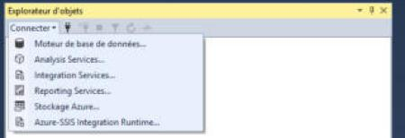

Au démarrage de SSMS, le même dialogue s'ouvre automatiquement (réglage par défaut, voir [05-menus-options.md](05-menus-options.md)).

## 1.2 Le dialogue en mode compact

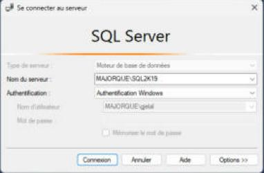

De haut en bas :

| Champ | Type | Comportement |
|---|---|---|
| **Type de serveur** | liste | « Moteur de base de données » par défaut. |
| **Nom du serveur** | liste modifiable (on peut taper ou choisir) | Pré-rempli avec **le dernier serveur utilisé**, texte entièrement sélectionné : on peut taper directement par-dessus. |
| **Authentification** | liste | 5 choix (voir ci-dessous). |
| **Connexion** / **Nom d'utilisateur** | liste modifiable | En authentification SQL Server : champ « Connexion » modifiable, avec historique des identifiants. En authentification Windows : « Nom d'utilisateur » grisé, affiche le compte Windows courant (`MACHINE\utilisateur`). |
| **Mot de passe** | champ masqué | Actif seulement en authentification SQL Server. |
| **Mémoriser le mot de passe** | case à cocher | Active seulement en authentification SQL Server. |

Boutons du bas : **Connexion** (bouton par défaut : `Entrée` le déclenche), **Annuler**, **Aide**, **Options >>**.

### Liste « Authentification »

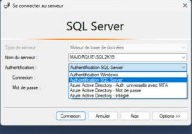

1. Authentification Windows
2. Authentification SQL Server
3. Azure Active Directory - Auth. universelle avec MFA
4. Azure Active Directory - Mot de passe
5. Azure Active Directory - Intégré

Changer de mode active ou grise immédiatement les champs *Connexion*, *Mot de passe* et *Mémoriser le mot de passe*.

### Historique des serveurs (liste « Nom du serveur »)

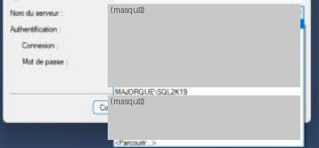

*(Les noms des autres serveurs de l'historique ont été masqués sur la capture.)*

- La liste déroulante affiche **tous les serveurs déjà utilisés**, le plus récent en premier.
- La dernière entrée est toujours **`<Parcourir…>`**, qui ouvre une recherche des serveurs disponibles sur le réseau et sur la machine.
- **Choisir un serveur dans l'historique restaure aussi sa méthode d'authentification, son identifiant et, s'il a été mémorisé, son mot de passe.** Observé : en choisissant un serveur enregistré avec un compte SQL Server, le dialogue est repassé tout seul en « Authentification SQL Server » avec l'identifiant et le mot de passe (masqué) remplis.
- On peut aussi taper un nom qui n'est pas dans la liste ; il y est ajouté après une connexion réussie.

## 1.3 Le bouton « Options >> »

Un clic agrandit le dialogue vers le bas, ajoute une rangée d'onglets et **ouvre directement l'onglet « Propriétés de connexion »**. Le bouton devient **Options <<** (un nouveau clic replie le dialogue). À chaque nouvelle ouverture du dialogue, celui-ci revient en mode compact.

Les onglets : **Connexion**, **Propriétés de connexion**, **Always Encrypted**, **Paramètres de connexion supplémentaires**. Ils ne tiennent pas tous en largeur : deux petites flèches ◂ ▸ à droite font défiler la rangée.

### Onglet « Connexion »

Reprend les champs du mode compact (Type de serveur, Nom du serveur, Authentification, Nom d'utilisateur, Mot de passe, Mémoriser), sous un titre « Serveur » et la phrase « Tapez le nom du serveur, ou choisissez-le dans la liste déroulante. »

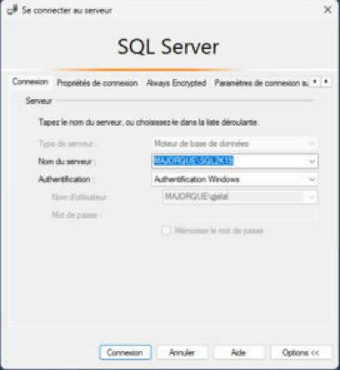

### Onglet « Propriétés de connexion »

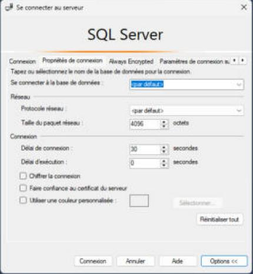

| Champ | Valeur par défaut | Rôle |
|---|---|---|
| **Se connecter à la base de données** | `<par défaut>` | Base dans laquelle la connexion s'ouvre. |
| Réseau > **Protocole réseau** | `<par défaut>` | Choix : *Canaux nommés*, *Mémoire partagée*, *TCP/IP*. |
| Réseau > **Taille du paquet réseau** | 4096 octets | |
| Connexion > **Délai de connexion** | 30 secondes | Temps d'attente maximal pour joindre le serveur. |
| Connexion > **Délai d'exécution** | 0 seconde | 0 = pas de limite pour l'exécution des requêtes. |
| **Chiffrer la connexion** | décochée | |
| **Faire confiance au certificat du serveur** | décochée | |
| **Utiliser une couleur personnalisée** | décochée | Cochée, active le bouton **Sélectionner…** et un carré de couleur. La couleur choisie colore la barre d'état des fenêtres de requête de cette connexion (pratique pour repérer un serveur de production). *Non cochée pendant l'observation, pour ne pas modifier l'historique enregistré.* |
| Bouton **Réinitialiser tout** | | Remet tous les champs de l'onglet à leur valeur par défaut. |

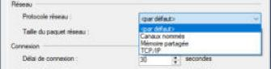

**La liste « Se connecter à la base de données »** contient `<par défaut>` et `<Parcourir le serveur…>`. On peut aussi y taper un nom de base.

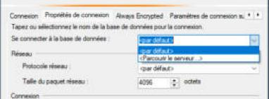

Choisir `<Parcourir le serveur…>` affiche d'abord une confirmation :

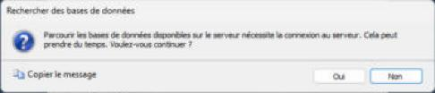

> « Parcourir les bases de données disponibles sur le serveur nécessite la connexion au serveur. Cela peut prendre du temps. Voulez-vous continuer ? » — **Oui** / **Non** (Non est le bouton par défaut).

Sur **Oui**, SSMS se connecte avec les informations de l'onglet *Connexion* et ouvre une fenêtre **« Rechercher une base de données sur le serveur »** : un arbre avec le serveur, un dossier *Bases de données système* (master, model, msdb, tempdb) et un dossier *Bases de données utilisateur*. **OK** reste grisé tant qu'on n'a pas choisi une base (un dossier ne suffit pas).

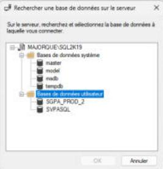

Après **OK**, le nom de la base s'affiche dans le champ. **Effet observé** : la base choisie ici devient la base de départ de la connexion, et donc la base des nouvelles requêtes ouvertes depuis ce serveur (voir 1.6).

### Onglet « Always Encrypted »

Une case **Activer Always Encrypted (chiffrement de colonne)** et un champ **URL de l'attestation d'enclave**, avec un lien *En savoir plus*. *(Always Encrypted : chiffrement de certaines colonnes, déchiffrées seulement côté client.)*

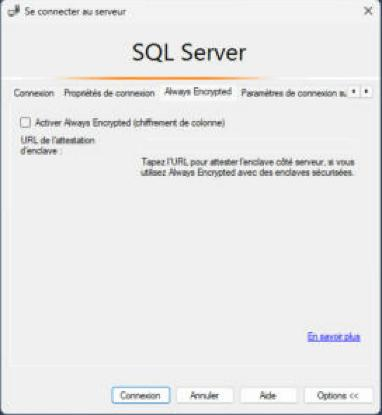

### Onglet « Paramètres de connexion supplémentaires »

Une grande zone de texte libre pour ajouter des paramètres à la chaîne de connexion. Deux avertissements : ils sont « envoyés en texte clair », et ils « remplacent les sélections graphiques dans les autres panneaux ».

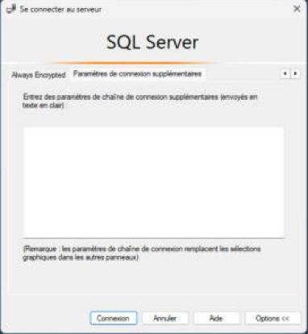

## 1.4 Connexion réussie, connexion en cours, échec

**Pendant la connexion** : tous les champs et boutons sont grisés sauf **Annuler**, et une fine barre orange animée défile sous le titre « SQL Server ».

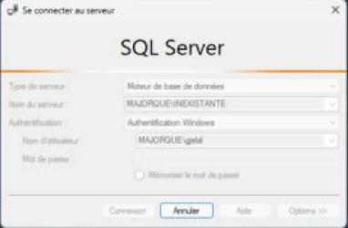

**Réussite** : le dialogue se ferme ; le serveur apparaît dans l'explorateur d'objets, **sélectionné et déplié** au premier niveau.

**Échec** (testé avec un nom d'instance inexistant) : après environ 35 secondes, un message d'erreur s'affiche **par-dessus** le dialogue de connexion :

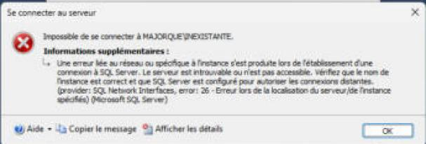

- Titre « Se connecter au serveur », icône rouge, phrase courte « Impossible de se connecter à MAJORQUE\INEXISTANTE. »
- Sous **Informations supplémentaires**, le message technique complet (ici l'erreur réseau 26).
- En bas : menu **Aide ▾**, **Copier le message**, **Afficher les détails**, et **OK**.
- **Afficher les détails** ouvre une fenêtre « Informations avancées » : à gauche l'arbre des messages (message principal, message interne, lien d'aide, données supplémentaires, emplacement du programme), à droite le détail (numéro d'erreur, gravité, état). Bouton **Fermer**.
- Après **OK**, on revient au dialogue de connexion **resté ouvert avec les valeurs saisies** : on peut corriger le nom et réessayer sans tout retaper.

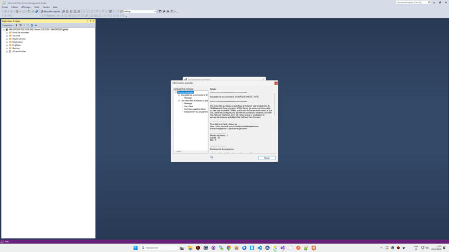

## 1.5 Plusieurs serveurs à la fois

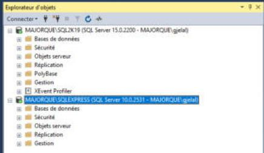

- Chaque nouvelle connexion ajoute **un nœud racine à la fin** de l'arbre. Les serveurs déjà connectés restent tels quels (déplié ou replié).
- Libellé d'un nœud serveur : `NOM_SERVEUR (SQL Server <version> - <utilisateur>)`, par exemple `MAJORQUE\SQL2K19 (SQL Server 15.0.2200 - MAJORQUE\gjelal)`.
- L'icône du serveur porte une petite pastille verte (serveur démarré).
- **Le contenu dépend de la version du serveur** : sous SQL Server 2019, on voit *Bases de données, Sécurité, Objets serveur, Réplication, PolyBase, Gestion, XEvent Profiler* ; sous SQL Server 2008, seulement *Bases de données, Sécurité, Objets serveur, Réplication, Gestion*. Selon les droits et la configuration, on voit aussi *Haute disponibilité Always On*, *Catalogues Integration Services* et *SQL Server Agent*.

## 1.6 Déconnexion

**Dans l'explorateur** : sélectionner le serveur puis l'icône **Déconnecter** (3ᵉ bouton de la barre de l'explorateur, info-bulle « Déconnecter »), ou clic droit > **Déconnexion**.

- Le nœud du serveur **disparaît immédiatement, sans confirmation**.
- **Les fenêtres de requête ouvertes sur ce serveur ne sont pas touchées** : elles gardent leur propre connexion et restent utilisables. L'explorateur et chaque fenêtre de requête ont des connexions séparées.

**Dans une fenêtre de requête** : voir 1.8.

## 1.7 Lien entre une fenêtre de requête, un serveur et une base

Chaque fenêtre de requête possède **sa propre connexion** (son propre SPID), avec un serveur et une base courante. Cette information apparaît à cinq endroits :

1. **Le titre de l'onglet** : `SQLQuery3.sql - MA...ORQUE\gjelal (52))` (tronqué au milieu quand c'est trop long).
2. **L'info-bulle de l'onglet** (au survol) : le nom complet, `SQLQuery1.sql - MAJORQUE\SQL2K19.SVPASQL (MAJORQUE\gjelal (51))`, c'est-à-dire *fichier - serveur.base (utilisateur (SPID))*.
3. **Le titre de la fenêtre SSMS** : le même texte complet, suivi de « - Microsoft SQL Server Management Studio ».
4. **La liste déroulante des bases** dans la barre d'outils SQL.
5. **La barre d'état jaune** en bas de la fenêtre de requête : serveur (avec version), utilisateur (SPID), base, durée, nombre de lignes.


### La liste déroulante des bases (barre d'outils SQL)


- Info-bulle : **« Bases de données disponibles (Ctrl+U) »**. `Ctrl+U` place le focus dans la liste pour choisir au clavier.
- Elle liste **toutes les bases du serveur de la fenêtre active** (système et utilisateur), et seulement celles-là.
- Elle affiche toujours **la base courante de la fenêtre de requête active**. Changer d'onglet change son contenu.
- **Choisir une base change immédiatement la base courante** de la connexion : le titre de la fenêtre et la barre d'état se mettent à jour tout de suite, sans rien exécuter. Le texte de la requête n'est pas modifié et l'onglet n'est pas marqué comme modifié.
- Elle est **grisée** quand la fenêtre n'est pas connectée.

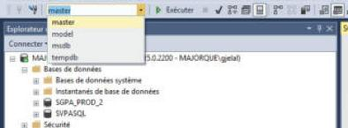

### Effet de `USE MaBase`

Testé avec :

```sql
USE msdb;
SELECT DB_NAME() AS base_courante;
```

Après exécution (`F5`), **la liste déroulante, le titre de la fenêtre et la barre d'état passent tous à `msdb`**. Le `USE` a le même effet que de choisir la base dans la liste, mais seulement au moment où il est exécuté. La base reste `msdb` pour les exécutions suivantes, jusqu'au prochain changement.

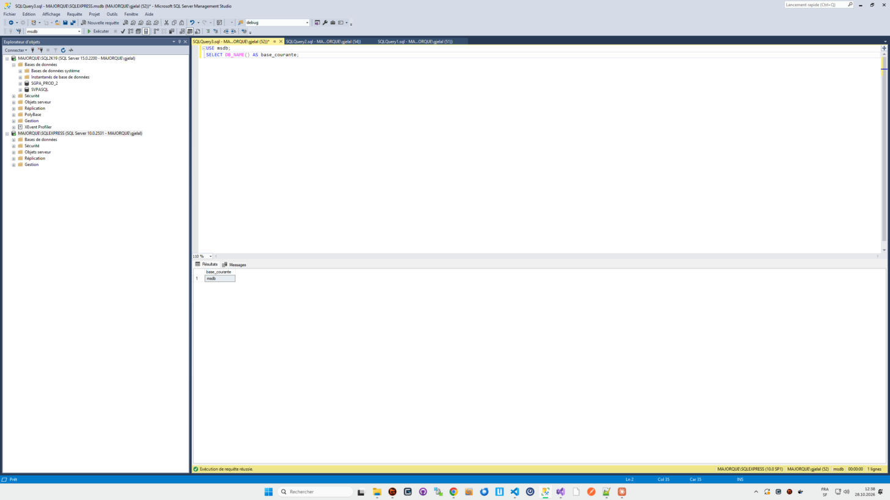

## 1.8 Changer la connexion d'une fenêtre de requête

Clic droit dans l'éditeur > **Connexion** ▸ sous-menu :

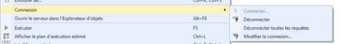

| Entrée | Effet |
|---|---|
| **Connecter…** | Grisé si la fenêtre est déjà connectée. Sinon, ouvre le dialogue de connexion. |
| **Déconnecter** | Ferme la connexion de cette fenêtre seulement. |
| **Déconnecter toutes les requêtes** | Ferme la connexion de toutes les fenêtres de requête. |
| **Modifier la connexion…** | Ouvre le dialogue de connexion, titré **« Se connecter au moteur de base de données »**, pré-rempli avec le serveur actuel de la fenêtre. |

Les mêmes actions existent dans le menu **Requête > Connexion** et dans les deux premiers boutons de la barre d'outils SQL (voir [04-execution-resultats.md](04-execution-resultats.md)).

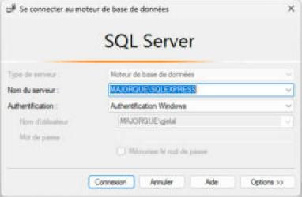

**Modifier la connexion**, testé de SQLEXPRESS (base `msdb`) vers SQL2K19 :

- La fenêtre se reconnecte au nouveau serveur, avec **un nouveau SPID**, dans **la base par défaut** du nouveau serveur (`master`), et non dans la base où l'on était avant.
- Le texte de la requête et **les résultats de la dernière exécution restent affichés**.
- Le titre, l'onglet, la liste des bases et la barre d'état se mettent à jour.
- La barre d'état affiche « Connecté. (1/1) ».

**Déconnecter** :

- L'onglet devient `SQLQuery3.sql - non connecté*`, le titre de la fenêtre aussi.
- La liste des bases est grisée.
- La barre d'état jaune affiche seulement « Déconnecté. » (serveur, utilisateur et base disparaissent).
- Le texte et les résultats restent affichés ; le bouton **Exécuter** reste actif.
- **Si on exécute (`F5`) une fenêtre déconnectée**, SSMS ouvre le dialogue de connexion ; après **Connexion**, **la requête s'exécute aussitôt**, sans qu'il faille relancer `F5`.

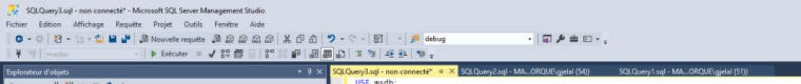

## 1.9 Quelle base pour une nouvelle requête ?

Voir le détail dans [02-requetes-et-fichiers.md](02-requetes-et-fichiers.md). En résumé, la nouvelle requête prend le serveur **de l'élément sélectionné dans l'explorateur** et :

- si une **base** (ou un objet d'une base) est sélectionnée : cette base ;
- si c'est le **serveur** qui est sélectionné : la base de départ de la connexion de l'explorateur (celle choisie dans *Options > Se connecter à la base de données*, sinon la base par défaut de l'identifiant, souvent `master`).
