# 2. Nouvelles requêtes et fichiers

> **Vocabulaire**
> - **Onglet de document** : chaque fenêtre de requête ou fichier ouvert apparaît comme un onglet au-dessus de l'éditeur.
> - **Focus** : l'élément de l'interface qui reçoit le clavier (l'explorateur ou l'éditeur, par exemple).
> - **Épingler** : fixer un onglet à gauche pour qu'il ne soit pas fermé par « tout fermer ».

---

## 2.1 Nouvelle requête : à quelle connexion est-elle rattachée ?

Trois moyens : `Ctrl+N`, le bouton **Nouvelle requête** de la barre d'outils standard, ou clic droit sur un serveur ou une base > **Nouvelle requête**. Dans le menu **Fichier > Nouveau**, `Ctrl+N` s'appelle précisément **« Requête avec la connexion actuelle »**.

Une nouvelle fenêtre de requête **ouvre toujours sa propre connexion** (nouveau SPID), déjà connectée : pas de dialogue. Le serveur et la base dépendent de **là où est le focus** :

| Contexte au moment de `Ctrl+N` / bouton | Serveur | Base |
|---|---|---|
| Focus dans l'**explorateur**, une **base** sélectionnée | serveur de cette base | **cette base** |
| Focus dans l'explorateur, le **serveur** sélectionné | ce serveur | base de départ de la connexion de l'explorateur : celle choisie dans *Options > Se connecter à la base de données*, sinon la base par défaut de l'identifiant (ici `master`) |
| Focus dans l'**éditeur** d'une requête connectée | serveur de cette requête | **base courante de cette requête** (même si elle a été changée par la liste ou par `USE`) |

Tests réalisés :

1. Serveur `SQL2K19` sélectionné (connexion ouverte avec la base `SVPASQL` dans les options) → `SQLQuery1.sql - MAJORQUE\SQL2K19.SVPASQL`.
2. Base `SGPA_PROD_2` sélectionnée, bouton *Nouvelle requête* → `SQLQuery2.sql - MAJORQUE\SQL2K19.SGPA_PROD_2`.
3. Serveur `SQLEXPRESS` sélectionné → `SQLQuery3.sql - MAJORQUE\SQLEXPRESS.master`.
4. Focus dans `SQLQuery5` dont la base a été passée à `msdb` → `SQLQuery6.sql - MAJORQUE\SQL2K19.msdb`.

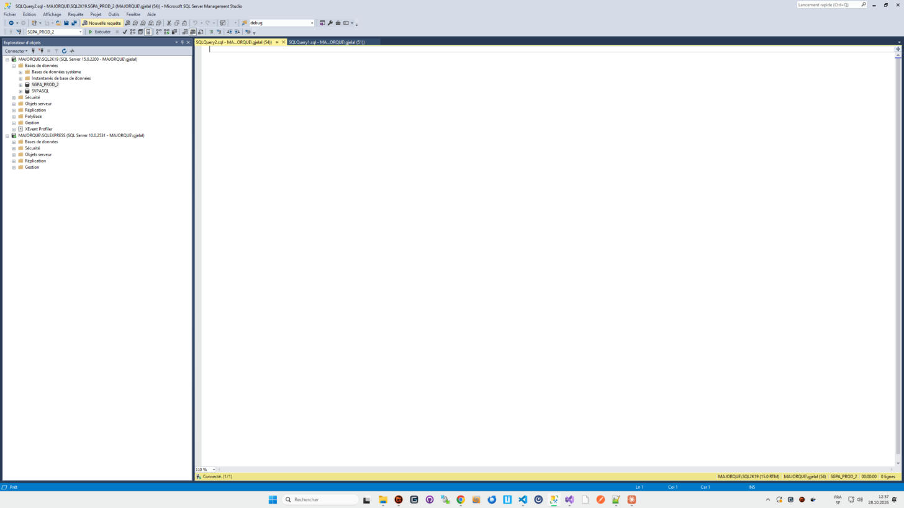

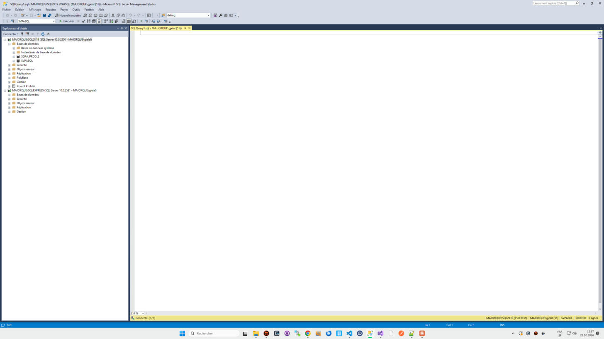

Ce qui change à l'ouverture de la première requête :

- Le menu **Requête** apparaît dans la barre de menus (entre *Affichage* et *Projet*). Il disparaît quand aucun éditeur de requête n'est actif.
- La barre d'outils SQL (2ᵉ rangée) s'active : liste des bases, Exécuter, etc.
- La barre d'état principale (tout en bas) passe au **bleu** et affiche `Ln`, `Col`, `Car`, `INS`.
- Une barre d'état **jaune** apparaît sous l'éditeur (voir [04-execution-resultats.md](04-execution-resultats.md)).
- L'éditeur est vide, curseur placé en ligne 1.

## 2.2 Nom des onglets

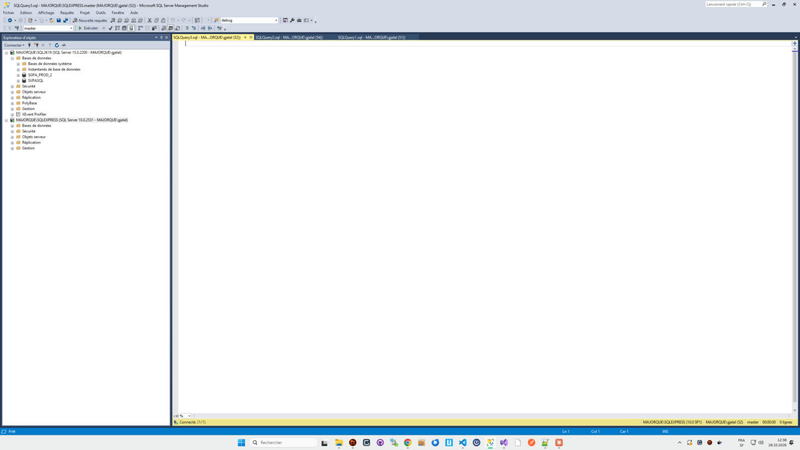

- **Format** : `NomFichier - SERVEUR.BASE (UTILISATEUR (SPID))`. Les nouvelles requêtes s'appellent `SQLQuery1.sql`, `SQLQuery2.sql`… Le numéro augmente à chaque nouvelle requête pendant la session SSMS, **même si les précédentes ont été fermées** (on a vu `SQLQuery4`, puis `SQLQuery5` après fermeture de `SQLQuery4`).
- **Troncature** : le texte de l'onglet est coupé au milieu avec `...` : `SQLQuery3.sql - MA...ORQUE\gjelal (52))`. Le début (fichier) et la fin (utilisateur, SPID) restent lisibles ; la partie serveur.base disparaît souvent.
- **Info-bulle** au survol : le nom complet, `SQLQuery1.sql - MAJORQUE\SQL2K19.SVPASQL (MAJORQUE\gjelal (51))`.
- **Titre de la fenêtre SSMS** : le même nom complet, suivi de `- Microsoft SQL Server Management Studio`.
- **Fenêtre non connectée** : `SQLQuery3.sql - non connecté`.
- **Ordre** : **un nouvel onglet s'insère tout à gauche** (juste après les onglets épinglés), et devient actif.
- **Onglet actif** : fond jaune ; il porte deux icônes à droite, une punaise (épingler) et une croix (fermer). Les onglets inactifs sont sur fond bleu foncé, texte blanc, sans icônes (elles apparaissent au survol).

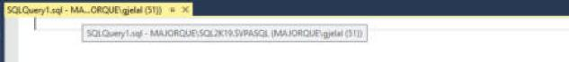

### Astérisque de modification

Dès qu'on tape dans l'éditeur, un `*` s'ajoute **à la fin du nom de l'onglet** (`…(52))*`) **et à la fin du titre de la fenêtre** (`…(52))* - Microsoft SQL Server Management Studio`). Il disparaît à l'enregistrement.

À gauche des lignes modifiées, une **barre verticale jaune** marque les lignes modifiées depuis le dernier enregistrement.

Changer la base dans la liste déroulante ne marque **pas** l'onglet comme modifié.

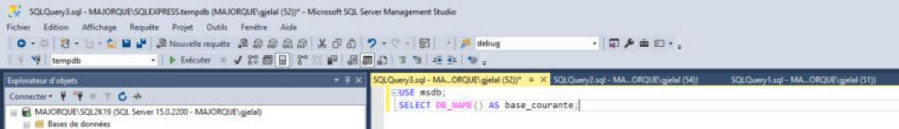

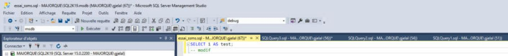

## 2.3 Enregistrer, enregistrer sous

| Action | Raccourci | Comportement |
|---|---|---|
| **Enregistrer** | `Ctrl+S` | Fichier jamais enregistré (`SQLQuery…`) : ouvre « Enregistrer le fichier sous ». Fichier existant : enregistre sans question. |
| **Enregistrer … sous…** | (menu Fichier) | Toujours le dialogue, ouvert **dans le dossier du fichier**, avec le chemin complet pré-rempli. |
| **Enregistrer tout** | `Ctrl+Maj+S` | Enregistre tous les documents modifiés. |

Les entrées du menu **Fichier** portent le nom du document actif : « Enregistrer essai_ssms.sql », « Enregistrer essai_ssms.sql sous… ».

**Dialogue « Enregistrer le fichier sous »** (dialogue standard de Windows) :

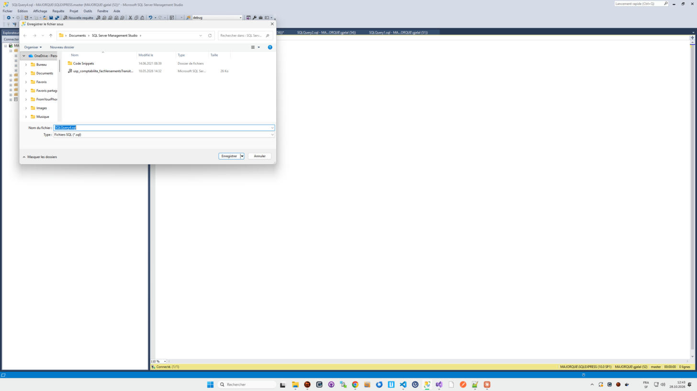

- Dossier par défaut pour une nouvelle requête : `Documents\SQL Server Management Studio`.
- *Nom du fichier* pré-rempli avec `SQLQuery4.sql`, entièrement sélectionné.
- *Type* : `Fichiers SQL (*.sql)`.
- Le bouton **Enregistrer** a une petite flèche qui ouvre : *Enregistrer*, **Enregistrer avec encodage…** (choix de l'encodage et des fins de ligne), *Afficher les versions précédentes*.

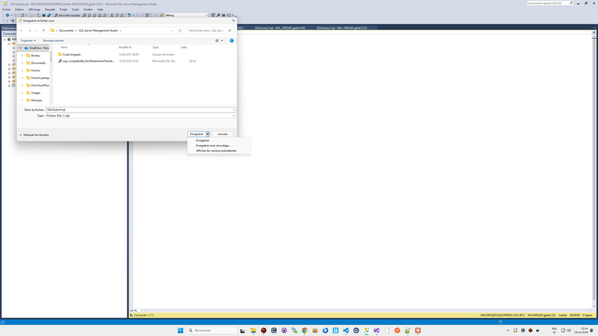

Après l'enregistrement, l'onglet et le titre prennent le nom du fichier (`essai_ssms.sql - …`) et l'astérisque disparaît.

Observé aussi : un chemin trop long (au-delà de la limite Windows de 260 caractères) est refusé par un message de SSMS (« La longueur du chemin d'accès… dépasse la longueur maximale autorisée… »).

## 2.4 Ouvrir un fichier

`Ctrl+O` ou **Fichier > Ouvrir > Fichier…** ouvre le dialogue Windows « Ouvrir un fichier », dans `Documents\SQL Server Management Studio`, filtre **Tous les fichiers (\*.\*)**.

**Connexion d'un fichier ouvert** : le fichier s'ouvre **déjà connecté, au serveur et à la base de la fenêtre de requête active** au moment de l'ouverture, avec un nouveau SPID. Test : `essai_ssms.sql`, créé sur `SQLEXPRESS.master`, a été rouvert alors que la fenêtre active était sur `SQL2K19.msdb` → il s'est ouvert sur `MAJORQUE\SQL2K19.msdb`. **Un fichier `.sql` ne mémorise pas sa connexion.**

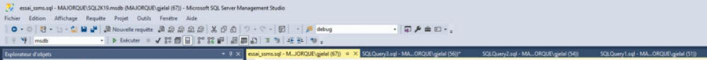

Le sous-menu **Fichier > Ouvrir** propose deux variantes explicites :

- **Fichier avec la nouvelle connexion…** : demande la connexion (dialogue) avant d'ouvrir.
- **Fichier déconnecté…** : ouvre le fichier sans connexion.

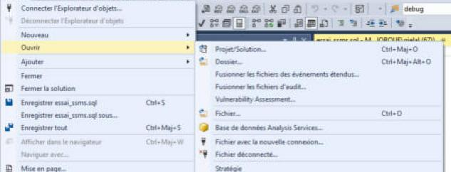

**Fichier > Fichiers récents** : les 10 derniers fichiers, numérotés de 1 à 10, avec un chemin raccourci au milieu (`C:\...\Normalisation\reprise_animaux_especes_races_couleurs.sql`). Le dernier enregistré est en tête.

## 2.5 Fermer un onglet non enregistré

Fermer par la croix de l'onglet, `Ctrl+F4`, ou clic droit sur l'onglet > **Fermer**.

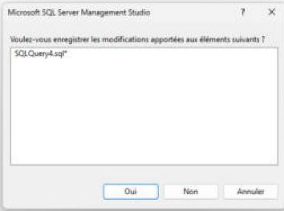

- Dialogue « Microsoft SQL Server Management Studio » : **« Voulez-vous enregistrer les modifications apportées aux éléments suivants ? »**, avec la liste des fichiers (`SQLQuery4.sql*`).
- **Oui** (par défaut) : enregistre (ouvre « Enregistrer sous » si le fichier est nouveau), puis ferme.
- **Non** : ferme sans enregistrer.
- **Annuler** : ne ferme pas.
- Après la fermeture, l'onglet voisin devient actif.
- Un onglet **non modifié** se ferme sans question.

## 2.6 Fermer SSMS avec des onglets ouverts

**Fichier > Quitter** (`Alt+F4`) avec des onglets modifiés affiche **un seul dialogue récapitulatif**, le même que ci-dessus, avec un arbre : `Solution1` > `Fichiers divers` > la liste de tous les fichiers modifiés (`essai_ssms.sql*`, `SQLQuery3.sql*`). Oui / Non / Annuler s'appliquent à tous. **Annuler** laisse SSMS ouvert, sans rien changer.

Les onglets non modifiés ne sont pas listés. *(La « solution » est le conteneur de projet hérité de Visual Studio ; SSMS en crée une, « Solution1 », de façon invisible.)*

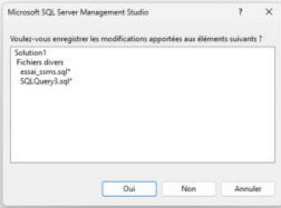

Non vérifié : si SSMS rouvre les onglets au démarrage suivant (nous n'avons pas fermé SSMS, pour ne pas perdre la session en cours).

## 2.7 Plusieurs onglets

**Réorganiser** : glisser un onglet le long de la rangée le déplace (vérifié). Pour sortir un onglet dans une fenêtre séparée : clic droit > *Rendre flottant* (non testé).

**Épingler** : la punaise de l'onglet actif, ou clic droit > **Épingler l'onglet**. L'onglet épinglé passe tout à gauche et garde sa punaise visible (dessinée verticale). Il n'est pas fermé par *Tout fermer, sauf celles épinglées*.

**Clic droit sur un onglet** :

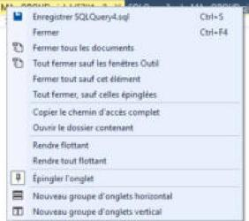

| Entrée | Raccourci |
|---|---|
| Enregistrer SQLQuery4.sql | `Ctrl+S` |
| Fermer | `Ctrl+F4` |
| Fermer tous les documents | |
| Tout fermer sauf les fenêtres Outil | |
| Fermer tout sauf cet élément | |
| Tout fermer, sauf celles épinglées | |
| Copier le chemin d'accès complet | |
| Ouvrir le dossier contenant | |
| Rendre flottant | |
| Rendre tout flottant | |
| Épingler l'onglet | |
| Nouveau groupe d'onglets horizontal | |
| Nouveau groupe d'onglets vertical | |

*Nouveau groupe d'onglets horizontal / vertical* coupe la zone d'édition en deux pour voir deux requêtes côte à côte.

**Onglets sur plusieurs connexions** : chaque onglet a sa propre connexion ; on peut mélanger librement serveurs et bases (voir la capture du 2.2, avec `SQLEXPRESS` et `SQL2K19`). **Passer d'un onglet à l'autre met à jour** la liste des bases, le titre de la fenêtre et la barre d'état jaune selon l'onglet actif.

**Navigation au clavier** : `Ctrl+Tab` ouvre normalement le sélecteur de fenêtres de Visual Studio ; non testé ici.

Non vérifié : la petite flèche ▾ tout à droite de la rangée d'onglets (liste de tous les onglets ouverts) n'a pas réagi à nos clics.
