# 3. Explorateur d'objets

> **Vocabulaire**
> - **Nœud** : une ligne de l'arbre (un serveur, un dossier, une table…). Le petit `⊞` / `⊟` à gauche le déplie ou le replie.
> - **Script** : un texte SQL. « Générer un script » veut dire que SSMS écrit le SQL à votre place, sans l'exécuter.
> - **Procédure stockée** : un programme SQL enregistré dans la base, qu'on lance avec `EXEC`.

Les menus ci-dessous ont été relevés sur une base de SQL Server 2019. **Aucune action d'écriture n'a été lancée** : les entrées comme *Supprimer*, *Renommer*, *Arrêter* ou *Modifier toutes les lignes* sont listées mais n'ont pas été cliquées.

---

## 3.1 La barre de l'explorateur

De gauche à droite, avec leur info-bulle :

| Bouton | Info-bulle | Rôle |
|---|---|---|
| **Connecter ▾** | | Menu des types de serveur (voir [01-connexions.md](01-connexions.md)). |
| prise | Connecter l'Explorateur d'objets | Ouvre le dialogue de connexion. |
| prise barrée | Déconnecter | Déconnecte le serveur du nœud sélectionné. |
| carré | Arrêter | Interrompt un chargement de l'arbre en cours. Grisé le reste du temps. |
| entonnoir | Filtre | Ouvre le filtre du dossier sélectionné. Actif seulement sur un dossier filtrable. |
| flèche circulaire | **Actualiser (F5)** | Recharge le nœud sélectionné et ses enfants. |
| | Afficher l'état d'intégrité de la stratégie pour tous les nœuds | |

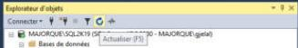
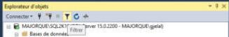

## 3.2 Arborescence d'une base

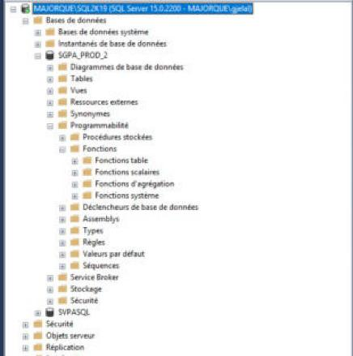

```
SERVEUR (SQL Server 15.0.2200 - utilisateur)
├─ Bases de données
│  ├─ Bases de données système        (master, model, msdb, tempdb)
│  ├─ Instantanés de base de données
│  └─ MaBase
│     ├─ Diagrammes de base de données
│     ├─ Tables
│     │  ├─ Tables système
│     │  ├─ FileTables
│     │  ├─ Tables externes
│     │  ├─ Tables de graphe
│     │  └─ dbo.MaTable
│     │     ├─ Colonnes        color_id (PK, int, non NULL) …
│     │     ├─ Clés
│     │     ├─ Contraintes
│     │     ├─ Déclencheurs
│     │     ├─ Index
│     │     └─ Statistiques
│     ├─ Vues
│     │  └─ Vues du système
│     ├─ Ressources externes
│     ├─ Synonymes
│     ├─ Programmabilité
│     │  ├─ Procédures stockées
│     │  │  └─ Procédures stockées système
│     │  ├─ Fonctions
│     │  │  ├─ Fonctions table
│     │  │  ├─ Fonctions scalaires
│     │  │  ├─ Fonctions d'agrégation
│     │  │  └─ Fonctions système
│     │  ├─ Déclencheurs de base de données
│     │  ├─ Assemblys
│     │  ├─ Types
│     │  ├─ Règles
│     │  ├─ Valeurs par défaut
│     │  └─ Séquences
│     ├─ Service Broker
│     ├─ Stockage
│     └─ Sécurité
├─ Sécurité
├─ Objets serveur
├─ Réplication
├─ PolyBase
├─ Gestion
└─ XEvent Profiler
```

Comportements observés :

- **Chargement à la demande** : un dossier met un court instant à se remplir au premier dépliage ; il est lu sur le serveur à ce moment-là.
- Dans chaque dossier, les sous-dossiers « système » viennent en premier, puis les objets, **triés par ordre alphabétique** et **préfixés par leur schéma** (`dbo.sgpa_colors`).
- Chaque type d'objet a son icône (table = grille, vue = grille avec lunettes, procédure = parchemin, colonne clé = clé).
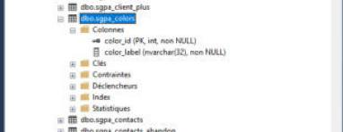

- **Colonnes** : libellé `nom (PK, type, NULL / non NULL)`, par exemple `color_id (PK, int, non NULL)`, `color_label (nvarchar(32), non NULL)`. *(PK = clé primaire ; « FK » pour une clé étrangère.)*
- L'arbre ne garde pas de « base active » : sélectionner une base dans l'explorateur ne change pas la base des fenêtres de requête déjà ouvertes. Cela compte seulement pour la **prochaine** nouvelle requête (voir [02-requetes-et-fichiers.md](02-requetes-et-fichiers.md)).

## 3.3 Clic droit sur un serveur

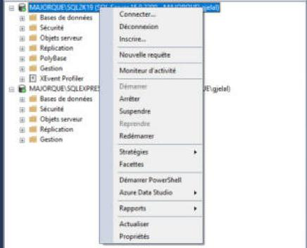

| Entrée | Remarque |
|---|---|
| Connecter… | Ouvre le dialogue de connexion. |
| Déconnexion | Retire le serveur de l'arbre, sans confirmation. |
| Inscrire… | Ajoute le serveur aux *Serveurs inscrits* (voir [06-divers.md](06-divers.md)). |
| **Nouvelle requête** | Requête sur ce serveur (base de départ de la connexion). |
| Moniteur d'activité | Ouvre le moniteur d'activité (voir 06). |
| Démarrer / Arrêter / Suspendre / Reprendre / Redémarrer | Pilotage du service SQL Server. Démarrer et Reprendre sont grisés quand le serveur tourne. |
| Stratégies ▸ | Afficher, Évaluer…, Supprimer les états d'intégrité |
| Facettes | |
| Démarrer PowerShell | |
| Azure Data Studio ▸ | Nouvelle requête, Nouveau bloc-notes |
| Rapports ▸ | Rapports standard ▸, Rapports personnalisés… |
| Actualiser | |
| Propriétés | |

**Rapports standard** (liste complète) : Tableau de bord Performances, Tableau de bord du serveur, Historique des modifications de la configuration, Historique des modifications du schéma, Santé du planificateur, Consommation de mémoire, Activité - Toutes les transactions bloquantes, Activité - Tous les curseurs, Activité - Curseurs principaux, Activité - Toutes les sessions, Activité - Sessions principales, Activité - Sessions dormantes, Activité - Connexions principales, Transactions principales par ancienneté, Transactions principales par nombre de transactions bloquées, Transactions principales par nombre de verrous, Performance - Statistiques d'exécution du lot, Performance - Statistiques d'exécution des objets, Performance - Requêtes principales par temps processeur moyen, Performance - Requêtes principales par nombre moyen d'E/S, Performance - Requêtes principales par temps processeur total, Performance - Requêtes principales par nombre total d'E/S, Statistiques Service Broker, État de l'envoi des journaux.

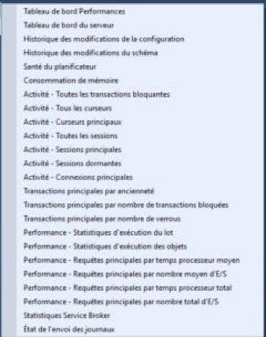

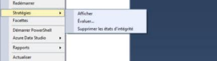
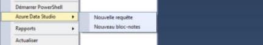

## 3.4 Clic droit sur une base

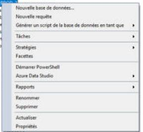

| Entrée | Sous-menu |
|---|---|
| Nouvelle base de données… | |
| **Nouvelle requête** | Requête connectée à **cette base**. |
| Générer un script de la base de données en tant que ▸ | CREATE To ▸, DROP To ▸, DROP et CREATE To ▸ (ALTER, CRÉER OU MODIFIER, SELECT/INSERT/UPDATE/DELETE, EXECUTE sont grisés). Chacun ouvre : *Nouvelle fenêtre d'éditeur de requête*, *Fichier…*, *Presse-papiers*. |
| Tâches ▸ | voir ci-dessous |
| Stratégies ▸ | |
| Facettes | |
| Démarrer PowerShell | |
| Azure Data Studio ▸ | |
| Rapports ▸ | |
| Renommer | |
| Supprimer | |
| Actualiser | |
| Propriétés | |

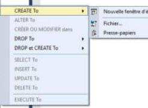

**Tâches ▸** : Détacher…, Mettre hors connexion, Mettre en ligne (grisé), Activer (grisé), Chiffrer les colonnes…, Découverte et classification des données ▸, Évaluation des vulnérabilités ▸, Réduire ▸, Sauvegarder…, Restaurer ▸, Générer des scripts…, Extraire une application de la couche Données…, Déployer une base de données vers Microsoft Azure SQL Database…, Exporter une application de la couche Données…, Mettre à niveau l'application de la couche Données…, Importer le fichier plat…, Importer des données…, Exporter les données…

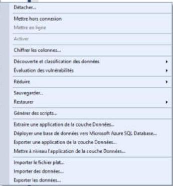

## 3.5 Clic droit sur une table

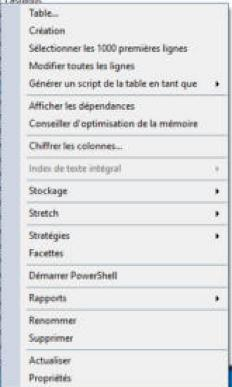

| Entrée | Effet |
|---|---|
| Table… | Ouvre le concepteur pour **créer une nouvelle table** (non ouvert ici). |
| Création | Ouvre le concepteur graphique de cette table (non ouvert ici). |
| **Sélectionner les 1000 premières lignes** | Voir 3.8. |
| Modifier toutes les lignes | Ouvre une grille modifiable des premières lignes (200 par défaut). **Non testé** (toute modification de cellule est écrite en base). |
| Générer un script de la table en tant que ▸ | voir ci-dessous |
| Afficher les dépendances | |
| Conseiller d'optimisation de la mémoire | |
| Chiffrer les colonnes… | |
| Index de texte intégral ▸ | grisé ici |
| Stockage ▸, Stretch ▸, Stratégies ▸ | |
| Facettes, Démarrer PowerShell | |
| Rapports ▸ | |
| Renommer, Supprimer | |
| Actualiser, Propriétés | |

**Générer un script de la table en tant que ▸** : CREATE To, DROP To, DROP et CREATE To, **SELECT To**, **INSERT To**, **UPDATE To**, **DELETE To** sont actifs ; ALTER To, CRÉER OU MODIFIER dans et EXECUTE To sont grisés. Chacun propose : **Nouvelle fenêtre d'éditeur de requête**, **Fichier…**, **Presse-papiers**.

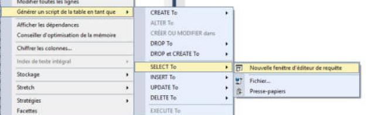

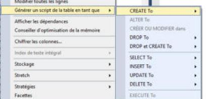

Résultat de **SELECT To > Nouvelle fenêtre d'éditeur de requête** : un nouvel onglet `SQLQuery7.sql`, connecté à la base de la table, **non exécuté** et non marqué comme modifié, contenant :

```sql
USE [SGPA_PROD_2]
GO

SELECT [color_id]
      ,[color_label]
  FROM [dbo].[sgpa_colors]
GO
```

Les colonnes sont listées une par ligne, la virgule en tête de ligne, les noms entre crochets.

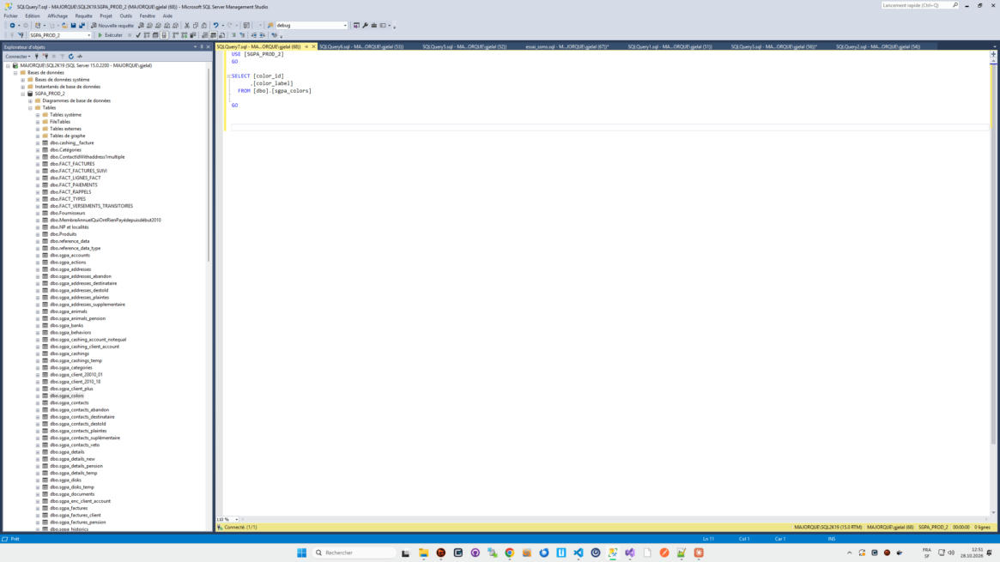

## 3.6 Clic droit sur une colonne

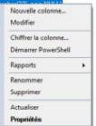

Nouvelle colonne…, Modifier, Chiffrer la colonne…, Démarrer PowerShell, Rapports ▸, Renommer, Supprimer, Actualiser, **Propriétés** (en gras : c'est l'action d'un double-clic).

## 3.7 Clic droit sur une procédure stockée et sur une vue

**Procédure stockée** :

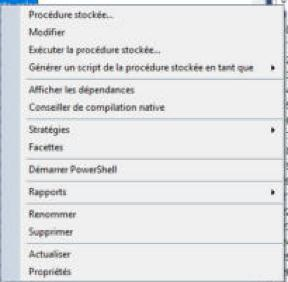

Procédure stockée… (nouvelle procédure), **Modifier**, **Exécuter la procédure stockée…**, Générer un script de la procédure stockée en tant que ▸, Afficher les dépendances, Conseiller de compilation native, Stratégies ▸, Facettes, Démarrer PowerShell, Rapports ▸, Renommer, Supprimer, Actualiser, Propriétés.

*Générer un script…* : CREATE To, **ALTER To**, **CRÉER OU MODIFIER dans**, DROP To, DROP et CREATE To, **EXECUTE To** actifs ; SELECT/INSERT/UPDATE/DELETE grisés.

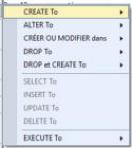

**Vue** :

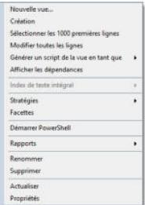

Nouvelle vue…, Création, Sélectionner les 1000 premières lignes, Modifier toutes les lignes, Générer un script de la vue en tant que ▸, Afficher les dépendances, Index de texte intégral ▸ (grisé), Stratégies ▸, Facettes, Démarrer PowerShell, Rapports ▸, Renommer, Supprimer, Actualiser, Propriétés.

**Fonctions** : non relevé en détail (même structure que les procédures).

## 3.8 Résultat de « Sélectionner les 1000 premières lignes »

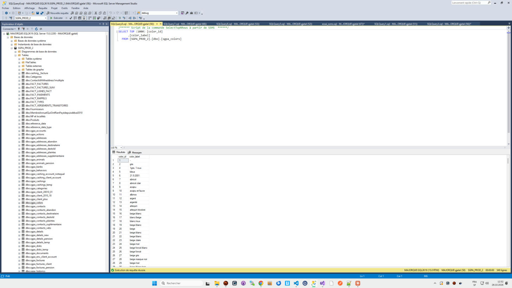

- Ouvre **un nouvel onglet** (`SQLQuery8.sql`), connecté au serveur et à **la base de la table**, et **l'exécute immédiatement**.
- Contenu :

```sql
/****** Script de la commande SelectTopNRows à partir de SSMS  ******/
SELECT TOP (1000) [color_id]
      ,[color_label]
  FROM [SGPA_PROD_2].[dbo].[sgpa_colors]
```

- Le nom de la table est **complet en trois parties** (`base.schéma.table`) ; il n'y a pas de `USE`.
- Le volet de résultats s'ouvre en dessous, sur l'onglet *Résultats* ; la barre d'état indique « Exécution de requête réussie. » et le nombre de lignes (549 ici).
- L'onglet n'est pas marqué comme modifié.
- Le nombre 1000 est réglable dans *Outils > Options > Explorateur d'objets SQL Server* (voir 05).

## 3.9 Résultat de « Modifier » sur une procédure

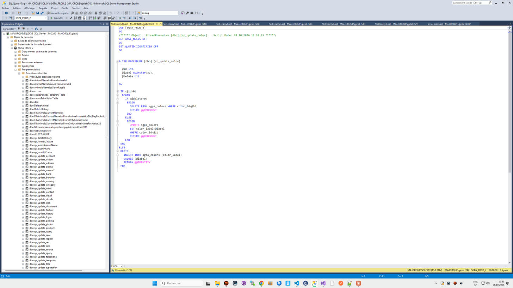

- Ouvre **un nouvel onglet** (`SQLQuery10.sql`), connecté à la base de la procédure, **non exécuté**, non marqué comme modifié.
- Contenu : le code actuel de la procédure, précédé d'un en-tête :

```sql
USE [SGPA_PROD_2]
GO
/****** Object:  StoredProcedure [dbo].[sp_update_color]    Script Date: 28.10.2026 12:53:53 ******/
SET ANSI_NULLS OFF
GO
SET QUOTED_IDENTIFIER OFF
GO

ALTER PROCEDURE [dbo].[sp_update_color]
  …
```

- `CREATE PROCEDURE` est remplacé par **`ALTER PROCEDURE`** : exécuter l'onglet (`F5`) remplacerait la procédure en base.
- Les options `SET ANSI_NULLS` / `SET QUOTED_IDENTIFIER` reprennent celles enregistrées avec la procédure.
- Le titre de l'onglet est un nom générique `SQLQueryN.sql`, pas le nom de la procédure.

*(Onglet fermé sans exécution pendant l'observation.)*

**« Procédure stockée… »** (nouvelle procédure) ouvre un onglet avec un **modèle** : un bloc de commentaires (« Template generated from Template Explorer… Use the Specify Values for Template Parameters command (Ctrl-Shift-M)… »), puis un squelette `CREATE PROCEDURE <Procedure_Name, sysname, ProcedureName>` avec des paramètres entre chevrons à remplir par `Ctrl+Maj+M`.

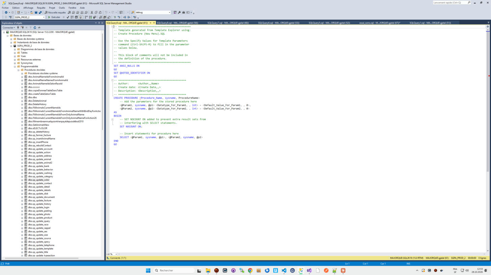

## 3.10 « Exécuter la procédure stockée… »

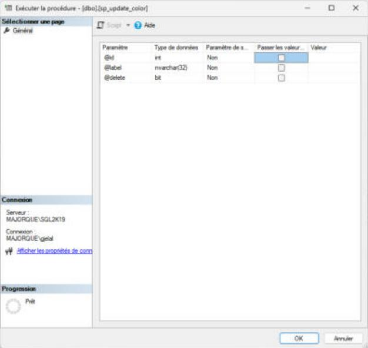

Ouvre une fenêtre « Exécuter la procédure - [dbo].[sp_update_color] » :

- à gauche : *Sélectionner une page* (Général), *Connexion* (serveur, identifiant, lien *Afficher les propriétés de connexion*), *Progression* (« Prêt ») ;
- à droite : une grille avec une ligne par paramètre : **Paramètre**, **Type de données**, **Paramètre de sortie** (Oui/Non), **Passer les valeurs NULL** (case à cocher), **Valeur** (à saisir) ;
- en haut : bouton **Script ▾** (grisé tant que rien n'est saisi) et **Aide** ;
- **OK** lance l'exécution de la procédure avec les valeurs saisies. *(Non testé : fermé avec Annuler, car la procédure écrit en base.)*

## 3.11 Filtrer l'arbre

Sur un dossier (Tables, Vues, Procédures stockées…) : icône **Filtre** de la barre, ou clic droit > **Filtre ▸** > *Paramètres de filtres* / *Supprimer un filtre*.

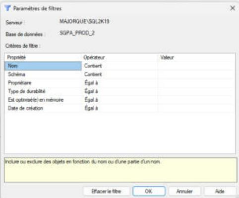

Le dialogue « Paramètres de filtres » rappelle le serveur et la base, puis propose une grille **Propriété / Opérateur / Valeur** :

| Propriété | Opérateur par défaut |
|---|---|
| Nom | Contient |
| Schéma | Contient |
| Propriétaire | Égal à |
| Type de durabilité | Égal à |
| Est optimisé(e) en mémoire | Égal à |
| Date de création | Égal à |

Une zone jaune en bas explique la propriété sélectionnée.

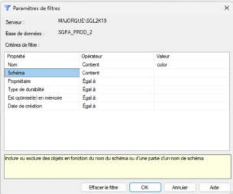

 Boutons : **Effacer le filtre**, **OK**, **Annuler**, **Aide**.

**Après OK** : le dossier devient **« Tables (filtré) »**, son icône prend un entonnoir, et il ne montre plus que les objets correspondants (les sous-dossiers système restent). Le filtre reste actif jusqu'à *Supprimer un filtre*.

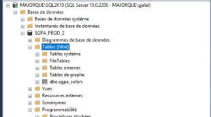

Pour l'enlever : clic droit sur le dossier > **Filtre ▸ Supprimer un filtre**.

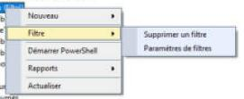

## 3.12 Actualiser

`F5` quand l'explorateur a le focus, le bouton Actualiser, ou clic droit > **Actualiser**. Seul le nœud sélectionné et ses enfants sont rechargés. Un objet créé par une requête n'apparaît pas tant qu'on n'a pas actualisé son dossier (comportement connu, non testé ici puisque nous n'avons rien créé).

*(Attention : `F5` exécute la requête quand c'est l'éditeur qui a le focus.)*

## 3.13 Glisser-déposer vers l'éditeur

| Ce qu'on glisse | Texte inséré |
|---|---|
| Une table | `[dbo].[sgpa_colors]` (schéma et nom entre crochets, sans la base) |
| Le dossier **Colonnes** d'une table | `color_id, color_label` (toutes les colonnes, séparées par une virgule, sans crochets) |

Le texte est inséré à l'endroit du dépôt (ou à la fin de la dernière ligne si on dépose sous le texte) et reste **sélectionné**. L'onglet est marqué comme modifié.

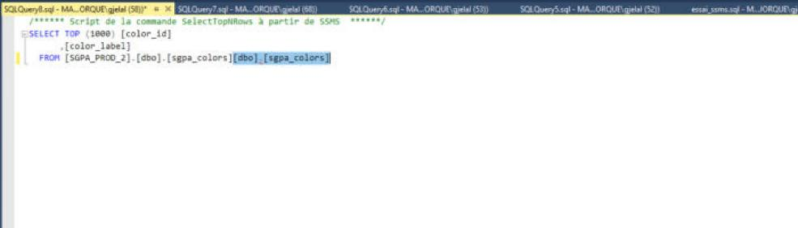
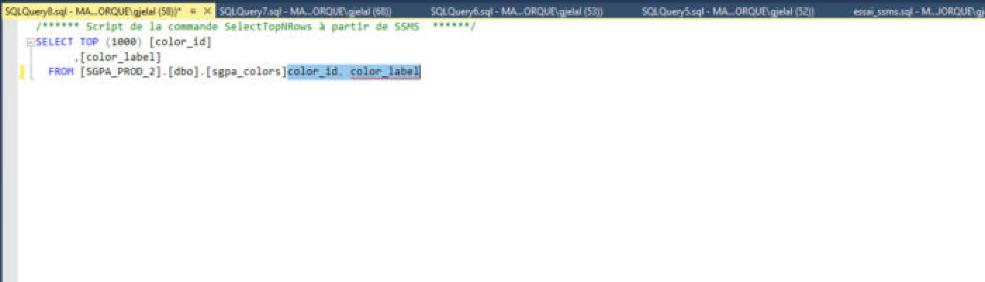
