# 4. Exécution et résultats

> **Vocabulaire**
> - **Lot** (*batch*) : un morceau de script envoyé d'un coup au serveur. Le mot-clé `GO` sépare les lots.
> - **Jeu de résultats** : le tableau renvoyé par un `SELECT`. Un script avec trois `SELECT` renvoie trois jeux.
> - **Plan d'exécution** : le schéma de la façon dont SQL Server compte exécuter (ou a exécuté) la requête.
> - **IntelliSense** : l'aide à la saisie (liste de propositions, soulignement rouge des erreurs).

Tous les tests ont été faits avec des `SELECT` sur les vues système (`sys.databases`, `sys.objects`, `sys.all_columns`).

---

## 4.1 La barre d'outils SQL (2ᵉ rangée)


Dans l'ordre, de gauche à droite, avec l'info-bulle exacte :

| # | Bouton | Info-bulle | Remarque |
|---|---|---|---|
| 1 | prise | **Connecter** | Grisé si la fenêtre est connectée. |
| 2 | prise + flèche | **Modifier la connexion** | |
| 3 | liste | **Bases de données disponibles (Ctrl+U)** | Voir [01-connexions.md](01-connexions.md). |
| 4 | ▶ Exécuter | **Exécuter (F5)** | Le seul bouton avec un libellé texte. |
| 5 | ■ rouge | **Annuler l'exécution de la requête (Alt+Break)** | Gris hors exécution, rouge pendant. |
| 6 | ✓ | **Analyser (Ctrl+F5)** | Vérifie la syntaxe sans exécuter. |
| 7 | | **Afficher le plan d'exécution estimé (Ctrl+L)** | |
| 8 | | **Options de requête** | Ouvre le dialogue des options de cette fenêtre. |
| 9 | | **IntelliSense activé (Ctrl+B, Ctrl+I)** | Bouton bascule (enfoncé = actif). |
| 10 | | **Inclure le plan d'exécution actuel (Ctrl+M)** | Bascule : le plan réel s'affiche après chaque exécution. |
| 11 | | **Inclure les statistiques des requêtes actives** | Bascule. |
| 12 | | **Inclure les statistiques du client (Maj+Alt+S)** | Bascule. |
| 13 | | **Résultats dans du texte (Ctrl+T)** | Groupe de 3 boutons exclusifs (un seul enfoncé). |
| 14 | | **Résultats dans des grilles (Ctrl+D)** | Valeur par défaut. |
| 15 | | **Résultats dans un fichier (Ctrl+Maj+F)** | |
| 16 | | **Commenter les lignes sélectionnées. (Ctrl+K, Ctrl+C)** | |
| 17 | | **Supprimer les marques de commentaire des lignes sélectionnées. (Ctrl+K, Ctrl+U)** | |
| 18 | | **Réduire le retrait** | |
| 19 | | **Augmenter le retrait** | |
| 20 | | **Spécifier les valeurs des paramètres du modèle (Ctrl+Maj+M)** | Pour les modèles à `<paramètres>`. |

*`Ctrl+K, Ctrl+C`* veut dire : `Ctrl+K`, puis `Ctrl+C`.

**Selon le contexte** : quand aucun éditeur de requête n'est actif, toute la barre est grisée. Pendant une exécution, **Exécuter**, la liste des bases et Analyser sont grisés ; seul **Annuler** (carré rouge) est actif.

## 4.2 Exécuter tout ou une sélection

| Action | Raccourci | Comportement |
|---|---|---|
| Exécuter | `F5`, `Ctrl+E`, bouton *Exécuter* | **Sans sélection : exécute tout le texte de l'onglet. Avec une sélection : exécute uniquement le texte sélectionné.** |
| Analyser | `Ctrl+F5` | Vérifie la syntaxe sans exécuter. |
| Masquer / afficher les résultats | `Ctrl+R` | Bascule. L'éditeur prend alors toute la hauteur ; les résultats ne sont pas perdus. |

Vérifié : `Ctrl+E` se comporte comme `F5`. Avec la seconde requête seule sélectionnée, seul son résultat (5 lignes) s'affiche ; le premier `SELECT` n'est pas exécuté.

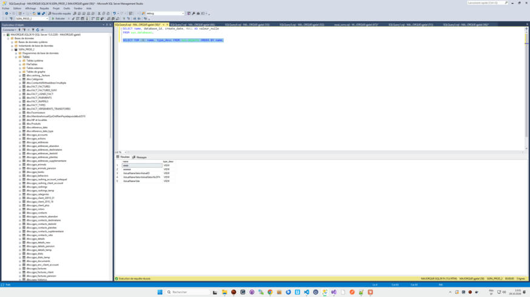

Chaque exécution **remplace** les résultats précédents (pas d'historique dans le volet).

Si la fenêtre n'est pas connectée, `F5` ouvre d'abord le dialogue de connexion, puis exécute (voir 01).

## 4.3 Le volet de résultats

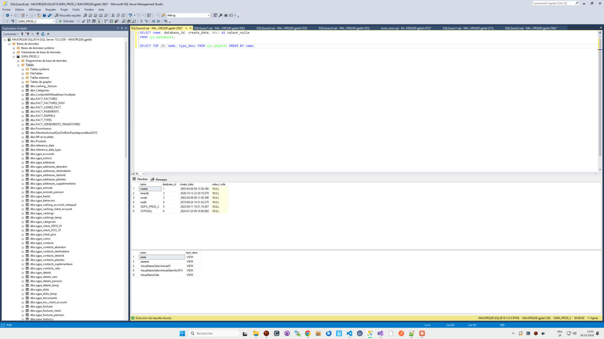

- Il apparaît **sous l'éditeur** à la première exécution, séparé par une barre de redimensionnement (glisser pour changer la hauteur ; non testé).
- **Onglets** en haut du volet : **Résultats** (icône grille) et **Messages**. Après une exécution réussie, *Résultats* est l'onglet actif.
- **Plusieurs jeux de résultats** : une grille par `SELECT`, **empilées verticalement** dans l'onglet *Résultats*, chacune avec ses propres en-têtes et barres de défilement. L'espace est partagé à parts égales ; une barre entre deux grilles permet de les redimensionner (non testé).
- Un `SELECT` qui ne renvoie aucune ligne affiche quand même une grille avec seulement les en-têtes.
- **Messages** après succès : une ligne `(6 lignes affectées)` par instruction, puis `Heure de fin : 2026-10-28T13:01:59.6465500+01:00`.

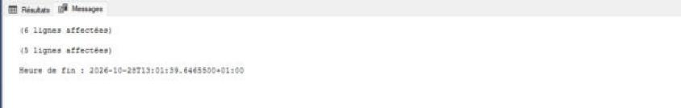
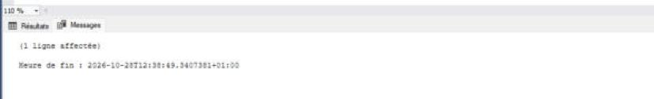

**Résultats en texte** (`Ctrl+T`, puis exécuter) : un seul onglet *Résultats* en police à chasse fixe ; les colonnes sont alignées avec une ligne de tirets sous les en-têtes ; les messages (`(6 lignes affectées)`, erreurs en rouge, heure de fin) sont mêlés au texte, et l'onglet *Messages* disparaît.

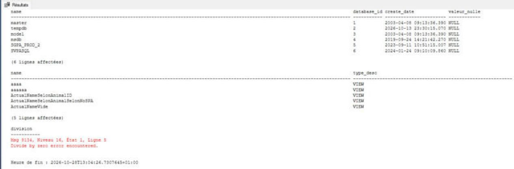

**Résultats dans un fichier** (`Ctrl+Maj+F`) : non testé (l'exécution demande un nom de fichier où écrire le résultat).

Le mode choisi (grille / texte / fichier) s'applique aux exécutions suivantes de la fenêtre de requête active (vérifié sur une seule fenêtre).

**Plan d'exécution estimé** (`Ctrl+L`) : la requête n'est pas exécutée ; le volet affiche les onglets *Messages* et **Plan d'exécution** avec le schéma (icônes d'opérateurs reliées par des flèches, coût en % sous chacune) et, en haut, `Requête 1 : coût de requête (par rapport au lot) : 100%` suivi du texte de la requête.

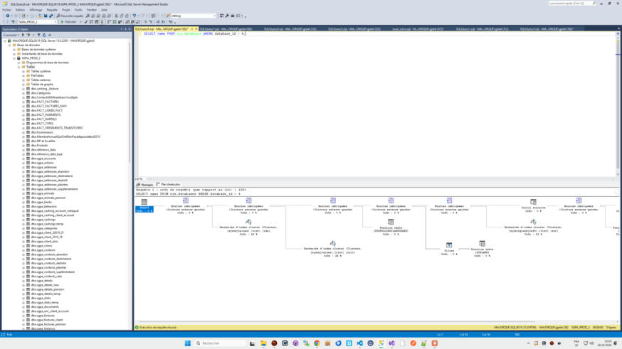

## 4.4 La grille

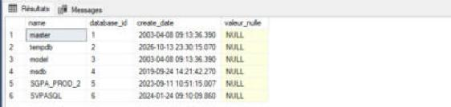

- Une colonne de **numéros de ligne** à gauche (1, 2, 3…), sur fond gris.
- Les en-têtes reprennent les noms ou alias de colonnes.
- **`NULL` est écrit en toutes lettres, sur fond jaune pâle**, pour le distinguer d'une chaîne vide.
- Les dates s'affichent au format `2003-04-08 09:13:36.390`.
- La cellule active est entourée d'un cadre.
- Largeur des colonnes : ajustée au contenu à l'affichage ; on peut la changer en glissant le bord d'un en-tête (non testé).

**Sélection** :

| Clic | Sélection |
|---|---|
| Sur une cellule | la cellule |
| Sur un **en-tête de colonne** | toute la colonne |
| Sur un **numéro de ligne** | toute la ligne |
| Sur le **coin en haut à gauche** | toute la grille |
| `Ctrl+A` | toute la grille |
| `Maj+clic` / `Ctrl+clic` | plage / ajout (non testé) |

La sélection est en bleu.

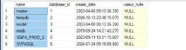
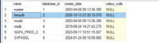
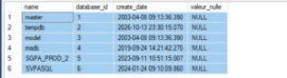

**Clic droit dans la grille** :

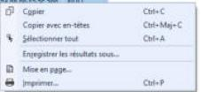

| Entrée | Raccourci |
|---|---|
| Copier | `Ctrl+C` |
| Copier avec en-têtes | `Ctrl+Maj+C` |
| Sélectionner tout | `Ctrl+A` |
| Enregistrer les résultats sous… | |
| Mise en page… | |
| Imprimer… | `Ctrl+P` |

**Format copié** (vérifié dans le presse-papiers) : colonnes séparées par une **tabulation**, lignes par un retour à la ligne Windows, `NULL` copié comme le texte `NULL`. *Copier avec en-têtes* ajoute une première ligne avec les noms de colonnes :

```
name	database_id	create_date	valeur_nulle
master	1	2003-04-08 09:13:36.390	NULL
tempdb	2	2026-10-13 23:30:15.070	NULL
```

**Enregistrer les résultats sous…** ouvre « Enregistrer les résultats de la grille » dans `Documents`, avec les types **CSV (délimité par des virgules) (\*.csv)** (par défaut), **Texte (délimité par des tabulations) (\*.txt)** et Tous les fichiers.

## 4.5 Messages selon l'issue

| Issue | Barre d'état jaune | Onglet actif | Contenu |
|---|---|---|---|
| Succès | ✔ vert **« Exécution de requête réussie. »** | Résultats | grilles + messages `(n lignes affectées)` |
| En cours | roue animée **« Exécution de la requête en cours… »**, chronomètre qui avance | — | volet vide |
| Erreur | ⚠ **« Requête terminée avec des erreurs. »** | **Messages** | messages en **rouge** |
| Annulée | ✖ rouge **« Requête annulée. »** | Messages | « Requête annulée par l'utilisateur. » |

### Erreur

Format du message (en rouge) :

```
Msg 207, Niveau 16, État 1, Ligne 5
Invalid column name 'colonne_absente'.
```

Le texte de l'erreur est dans la langue du serveur (ici anglais), l'en-tête `Msg / Niveau / État / Ligne` dans celle de SSMS.

Deux cas observés :

1. **Erreur de compilation** (colonne inconnue) : tout le lot est refusé, **aucun résultat**, l'onglet *Résultats* n'existe pas, seul *Messages* est affiché. Barre d'état : 0 ligne. Un **repère rouge** apparaît dans la barre de défilement de l'éditeur, à la hauteur de la ligne fautive.

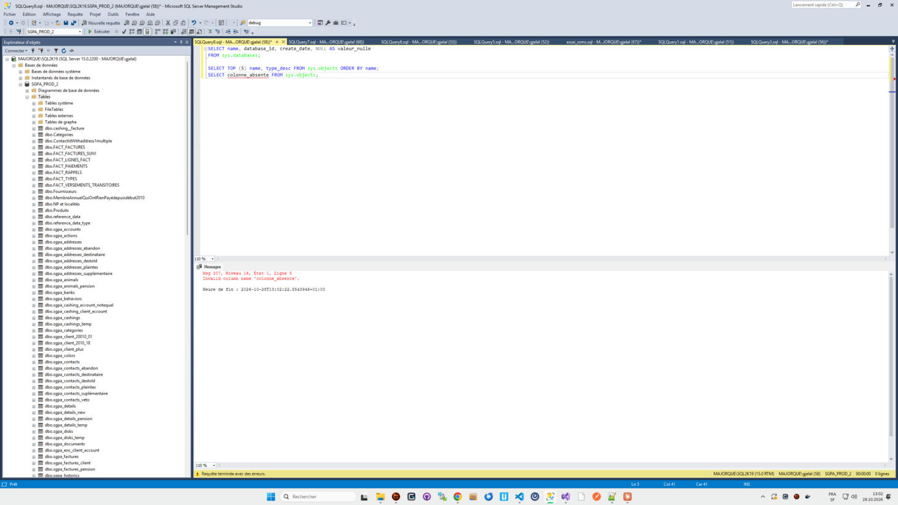

2. **Erreur d'exécution** (division par zéro, après deux `SELECT` réussis) : les deux premiers jeux de résultats sont affichés, plus une grille vide pour l'instruction en erreur ; **l'onglet Messages passe automatiquement au premier plan** ; il contient `(6 lignes affectées)`, `(5 lignes affectées)`, puis l'erreur en rouge.

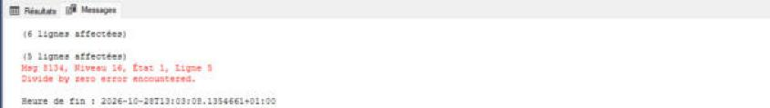
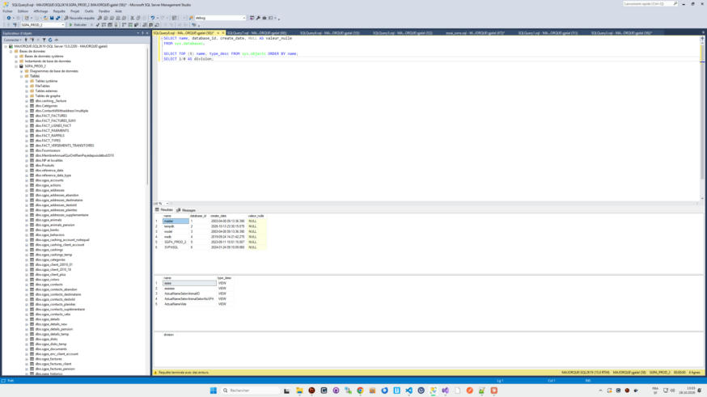

**Double-cliquer sur l'erreur** dans *Messages* : **le curseur va à la ligne indiquée dans l'éditeur et la ligne entière est sélectionnée**, la barre d'état principale affiche cette ligne (`Ln 5`). Le message cliqué est surligné.

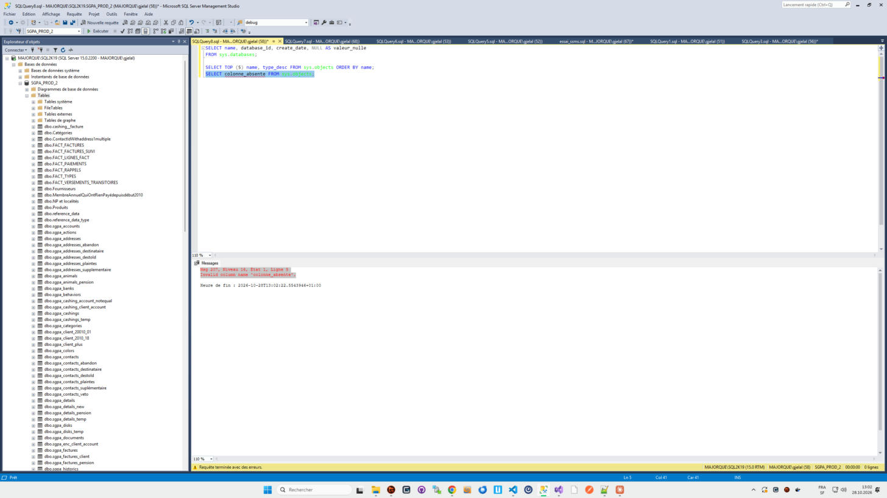

### Pendant une longue requête

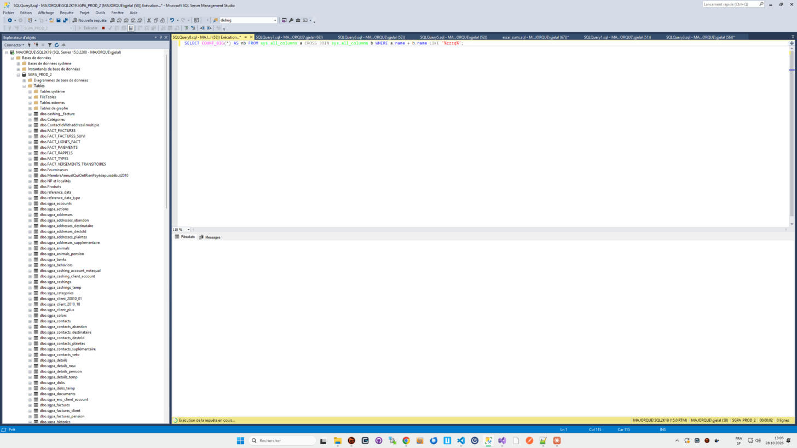

- L'onglet affiche **`Exécution...`** à la fin de son nom (`SQLQuery8.sql - MA...l (58)) Exécution...*`), le titre de la fenêtre aussi.
- La barre d'état jaune affiche la roue animée, « Exécution de la requête en cours… » et **le chronomètre qui avance** (`00:00:13`).
- Les résultats arrivent normalement au fur et à mesure dans la grille (non visible ici : la requête ne renvoyait qu'une ligne, à la fin).
- Les autres onglets restent utilisables (comportement connu, non testé ici).
- **Annuler** : carré rouge de la barre d'outils ou `Alt+Pause`. Après quelques instants : « Requête annulée par l'utilisateur. » dans *Messages*, « Requête annulée. » avec une croix rouge dans la barre d'état, durée figée.


## 4.6 Les barres d'état


**Barre d'état de la requête** (jaune, en bas de chaque fenêtre de requête), de gauche à droite :

| Zone | Exemple | Contenu |
|---|---|---|
| Icône + état | ✔ Exécution de requête réussie. | Connecté. (1/1) · Déconnecté. · Exécution de la requête en cours… · Requête terminée avec des erreurs. · Requête annulée. |
| Serveur | `MAJORQUE\SQL2K19 (15.0 RTM)` | nom du serveur et version |
| Utilisateur | `MAJORQUE\gjelal (58)` | identifiant et SPID |
| Base | `SGPA_PROD_2` | base courante |
| Durée | `00:00:03` | durée de la dernière exécution (chronomètre pendant l'exécution) |
| Lignes | `11 lignes` | total des lignes renvoyées par la dernière exécution, tous jeux confondus |

Couleur : **jaune** par défaut. Si une couleur personnalisée est définie pour la connexion (dialogue de connexion, onglet *Propriétés de connexion*), la barre prend cette couleur (non testé ici). « Connecté. (1/1) » signifie 1 connexion ouverte sur 1.

**Barre d'état principale** (tout en bas de SSMS) :


- À gauche : `Prêt` (ou l'état de SSMS).
- Quand un éditeur est actif : `Ln` (ligne), `Col` (colonne, tabulations développées), `Car` (caractère), `INS` / `RFP` (insertion / remplacement, touche `Inser`).
- Couleur : **bleue** quand un éditeur de requête est actif. Sans document ouvert, elle était **violette** pendant l'observation.

## 4.7 Menu contextuel de l'éditeur

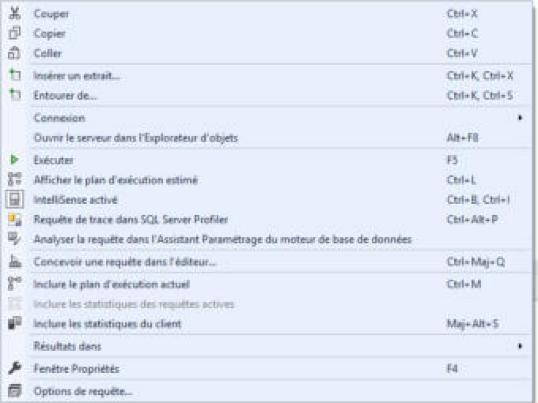

Couper `Ctrl+X` · Copier `Ctrl+C` · Coller `Ctrl+V` · Insérer un extrait… `Ctrl+K, Ctrl+X` · Entourer de… `Ctrl+K, Ctrl+S` · **Connexion ▸** · Ouvrir le serveur dans l'Explorateur d'objets `Alt+F8` · **Exécuter** `F5` · Afficher le plan d'exécution estimé `Ctrl+L` · IntelliSense activé `Ctrl+B, Ctrl+I` · Requête de trace dans SQL Server Profiler `Ctrl+Alt+P` · Analyser la requête dans l'Assistant Paramétrage du moteur de base de données · Concevoir une requête dans l'éditeur… `Ctrl+Maj+Q` · Inclure le plan d'exécution actuel `Ctrl+M` · Inclure les statistiques des requêtes actives · Inclure les statistiques du client `Maj+Alt+S` · Résultats dans ▸ · Fenêtre Propriétés `F4` · Options de requête…

## 4.8 Éditeur : comportements remarqués

- **Coloration** : mots-clés en bleu, fonctions système en rose (`COUNT_BIG`, `DB_NAME`), objets système en vert (`sys.databases`), chaînes en rouge, commentaires en vert, `NULL` en gris.
- **IntelliSense** : liste de propositions pendant la frappe ; les noms inconnus sont soulignés en rouge ondulé (par exemple des colonnes tant que le `FROM` n'est pas écrit). Attention : la touche `Entrée` ou `Tab` accepte la proposition en cours.
- **Repliage** : un `⊟` dans la marge gauche devant chaque instruction permet de la replier.
- **Marge de modification** : barre jaune devant les lignes modifiées et non enregistrées (verte après enregistrement, comportement Visual Studio, non vérifié ici).
- **Zoom** : liste `110 %` en bas à gauche de l'éditeur (et du volet de résultats).
