# 5. Menus et réglages

Barre de menus : **Fichier, Edition, Affichage, Requête, Projet, Outils, Fenêtre, Aide**. Le menu **Requête** n'apparaît que lorsqu'un éditeur de requête est actif.

Les menus sont **contextuels** : les entrées sans objet sont grisées (par exemple *Rétablir* tant qu'on n'a rien annulé), et certaines portent le nom du document actif (« Enregistrer SQLQuery8.sql »).

> **Valeurs observées** : les réglages ci-dessous sont ceux de ce poste. La plupart semblent être les valeurs par défaut de SSMS 18, mais certaines ont pu être changées sur ce poste (au moins une l'a été, voir *Commandes* en 5.7).

---

## 5.1 Fichier

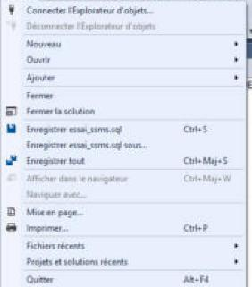

| Entrée | Raccourci |
|---|---|
| Connecter l'Explorateur d'objets… | |
| Déconnecter l'Explorateur d'objets | |
| Nouveau ▸ | |
| Ouvrir ▸ | |
| Ajouter ▸ | |
| Fermer | |
| Fermer la solution | |
| Enregistrer *fichier* | `Ctrl+S` |
| Enregistrer *fichier* sous… | |
| Enregistrer tout | `Ctrl+Maj+S` |
| Afficher dans le navigateur / Naviguer avec… | (grisés) `Ctrl+Maj+W` |
| Mise en page… | |
| Imprimer… | `Ctrl+P` |
| Fichiers récents ▸ | les 10 derniers fichiers |
| Projets et solutions récents ▸ | |
| Quitter | `Alt+F4` |

**Nouveau ▸** : Projet… `Ctrl+Maj+N` · Fichier… `Ctrl+Alt+N` · **Requête avec la connexion actuelle `Ctrl+N`** · Requête de moteur de base de données · Requête MDX / DMX / XMLA / DAX Analysis Services · Stratégie.

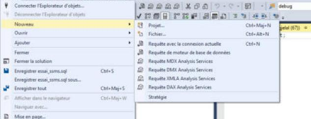

**Ouvrir ▸** : Projet/Solution… `Ctrl+Maj+O` · Dossier… `Ctrl+Maj+Alt+O` · Fusionner les fichiers des événements étendus… · Fusionner les fichiers d'audit… · Vulnerability Assessment… · **Fichier… `Ctrl+O`** · Base de données Analysis Services… · **Fichier avec la nouvelle connexion…** · **Fichier déconnecté…** · Stratégie.

## 5.2 Edition

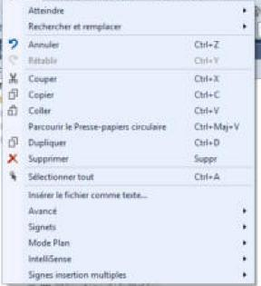

Atteindre ▸ · Rechercher et remplacer ▸ · Annuler `Ctrl+Z` · Rétablir `Ctrl+Y` · Couper `Ctrl+X` · Copier `Ctrl+C` · Coller `Ctrl+V` · Parcourir le Presse-papiers circulaire `Ctrl+Maj+V` · Dupliquer `Ctrl+D` · Supprimer `Suppr` · Sélectionner tout `Ctrl+A` · Insérer le fichier comme texte… · Avancé ▸ · Signets ▸ · Mode Plan ▸ · IntelliSense ▸ · Signes insertion multiples ▸

**Rechercher et remplacer ▸** : Recherche rapide `Ctrl+F` · Remplacement rapide `Ctrl+H` · Rechercher dans les fichiers · Remplacer dans les fichiers `Ctrl+Maj+H`.

**Avancé ▸** : Remplacer les espaces par des tabulations · Remplacer les tabulations par des espaces · Mettre en majuscules `Ctrl+Maj+U` · Mettre en minuscules `Ctrl+Maj+L` · Déplacer les lignes sélectionnées vers le haut `Alt+Flèche haut` / vers le bas `Alt+Flèche bas` · Supprimer les espaces blancs horizontaux `Ctrl+K, Ctrl+\` · Étendre la sélection au bloc contenant `Maj+Alt+^` · Afficher les espaces blancs `Ctrl+R, Ctrl+W` · Retour automatique à la ligne `Ctrl+E, Ctrl+W` · Recherche incrémentielle `Ctrl+I` · …

**IntelliSense ▸** : Liste des membres `Ctrl+J` · Informations sur les paramètres `Ctrl+Maj+Espace` · Info express `Ctrl+K, Ctrl+I` · Compléter le mot `Ctrl+Espace` · Activer/Désactiver le mode de saisie semi-automatique `Ctrl+Alt+Espace` · **Actualiser le cache local `Ctrl+Maj+R`** (à utiliser quand IntelliSense ne connaît pas encore un objet récent) · Entourer de… `Ctrl+K, Ctrl+S` · …

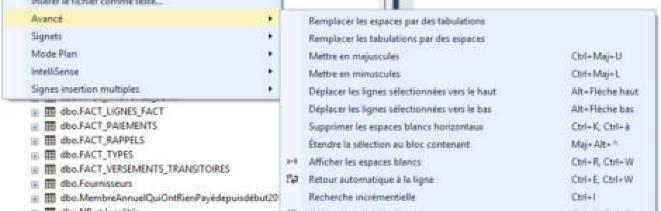
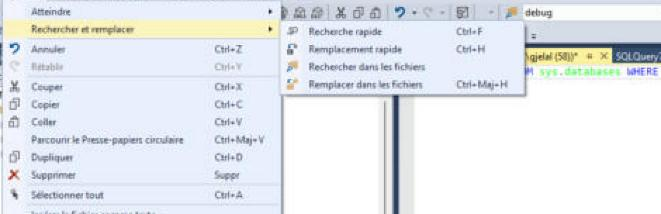
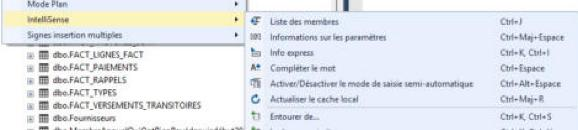

*Remarque* : `Ctrl+D` est à la fois « Dupliquer » (Edition) et « Résultats dans des grilles » (Requête) ; dans l'éditeur de requête, c'est le second qui a joué lors de nos essais.

## 5.3 Affichage

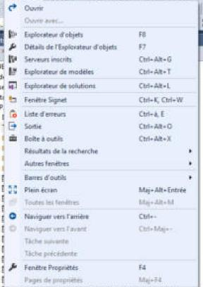

| Entrée | Raccourci |
|---|---|
| Ouvrir / Ouvrir avec… | |
| **Explorateur d'objets** | `F8` |
| Détails de l'Explorateur d'objets | `F7` |
| Serveurs inscrits | `Ctrl+Alt+G` |
| Explorateur de modèles | `Ctrl+Alt+T` |
| Explorateur de solutions | `Ctrl+Alt+L` |
| Fenêtre Signet | `Ctrl+K, Ctrl+W` |
| Liste d'erreurs | `Ctrl+\, E` |
| Sortie | `Ctrl+Alt+O` |
| Boîte à outils | `Ctrl+Alt+X` |
| Résultats de la recherche ▸ | |
| Autres fenêtres ▸ | Fenêtre Commande `Ctrl+Alt+A`, Navigateur web `Ctrl+Alt+R`, Structure du document, Affichage des ressources `Ctrl+Maj+E` |
| Barres d'outils ▸ | voir ci-dessous |
| Plein écran | `Maj+Alt+Entrée` |
| Toutes les fenêtres | `Maj+Alt+M` (grisé) |
| Naviguer vers l'arrière / l'avant | `Ctrl+-` / `Ctrl+Maj+-` |
| Tâche suivante / précédente | |
| Fenêtre Propriétés | `F4` |
| Pages de propriétés | `Maj+F4` |

**Barres d'outils ▸** : Compare Files, Concepteur de requêtes, Concepteur de tables, Concepteur de vues, Diagramme de base de données, Disposition, Générer, Navigateur web, **Standard ✔**, Éditeur de texte, **Éditeur SQL ✔**, Éditeur XML, Éditeurs SQL Server Analysis Services, Événements étendus, Personnaliser… *(✔ = affichée par défaut ; « Éditeur SQL » est la 2ᵉ rangée décrite en [04](04-execution-resultats.md).)*

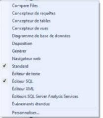
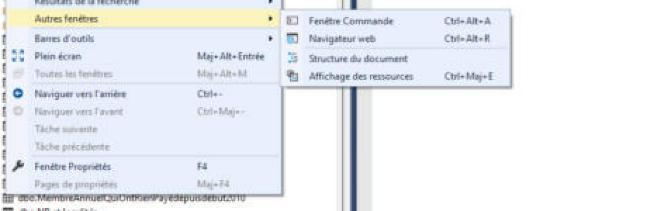

## 5.4 Requête

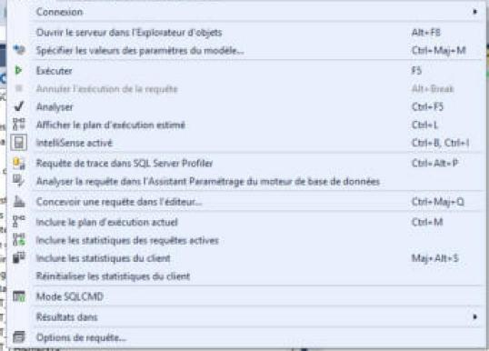

Connexion ▸ · Ouvrir le serveur dans l'Explorateur d'objets `Alt+F8` · Spécifier les valeurs des paramètres du modèle… `Ctrl+Maj+M` · **Exécuter `F5`** · Annuler l'exécution de la requête `Alt+Break` · Analyser `Ctrl+F5` · Afficher le plan d'exécution estimé `Ctrl+L` · IntelliSense activé `Ctrl+B, Ctrl+I` · Requête de trace dans SQL Server Profiler `Ctrl+Alt+P` · Analyser la requête dans l'Assistant Paramétrage du moteur de base de données · Concevoir une requête dans l'éditeur… `Ctrl+Maj+Q` · Inclure le plan d'exécution actuel `Ctrl+M` · Inclure les statistiques des requêtes actives · Inclure les statistiques du client `Maj+Alt+S` · Réinitialiser les statistiques du client · Mode SQLCMD · **Résultats dans ▸** (texte `Ctrl+T`, grilles `Ctrl+D`, fichier `Ctrl+Maj+F`) · Options de requête…

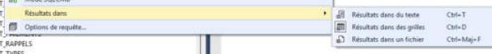

## 5.5 Outils

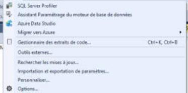

SQL Server Profiler · Assistant Paramétrage du moteur de base de données · Azure Data Studio · Migrer vers Azure ▸ · Gestionnaire des extraits de code… `Ctrl+K, Ctrl+B` · Outils externes… · Rechercher les mises à jour… · Importation et exportation de paramètres… · Personnaliser… · **Options…**

## 5.6 Fenêtre

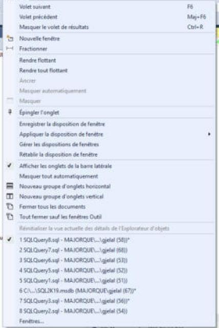

| Entrée | Raccourci |
|---|---|
| Volet suivant / précédent | `F6` / `Maj+F6` (passe d'un volet à l'autre, par exemple éditeur ↔ résultats ; non testé) |
| Masquer le volet de résultats | `Ctrl+R` |
| Nouvelle fenêtre | |
| Fractionner | coupe l'éditeur en deux vues du même texte (non testé) |
| Rendre flottant / Rendre tout flottant | |
| Ancrer / Masquer automatiquement / Masquer | grisés pour un document |
| Épingler l'onglet | |
| Enregistrer la disposition de fenêtre | |
| Appliquer la disposition de fenêtre ▸ | |
| Gérer les dispositions de fenêtres | |
| **Rétablir la disposition de fenêtre** | remet les panneaux à leur place d'origine |
| Afficher les onglets de la barre latérale ✔ | |
| Masquer tout automatiquement | |
| Nouveau groupe d'onglets horizontal / vertical | |
| Fermer tous les documents | |
| Tout fermer sauf les fenêtres Outil | |
| Réinitialiser la vue actuelle des détails de l'Explorateur d'objets | |
| **Liste des documents ouverts**, numérotés 1 à 8 (`1 SQLQuery8.sql - MAJORQUE\...\gjelal (58))*`), le document actif coché ✔ | |
| Fenêtres… | dialogue listant toutes les fenêtres |

## 5.7 Outils > Options

Dialogue redimensionnable, avec une **zone de recherche** en haut à gauche (« Options de recherche (Ctrl+E) »), l'arbre des catégories à gauche, la page à droite, **OK** / **Annuler** en bas. *(Fermé avec Annuler.)*

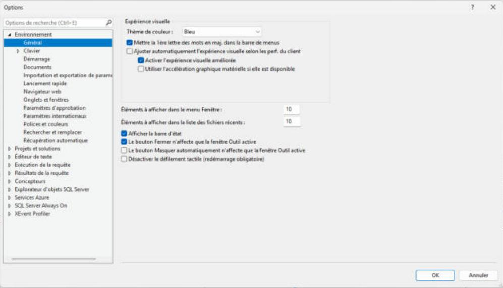

**Catégories** (premier niveau) :

- **Environnement** : Général, Clavier, Démarrage, Documents, Importation et exportation de paramètres, Lancement rapide, Navigateur web, Onglets et fenêtres, Paramètres d'approbation, Paramètres internationaux, Polices et couleurs, Rechercher et remplacer, Récupération automatique
- **Projets et solutions**
- **Éditeur de texte** : Général, Extension de fichier, Texte brut, Tous les langages, **Transact-SQL** (Général, Barres de défilement, Tabulations, IntelliSense), XML, **Onglet d'éditeur et barre d'état**
- **Exécution de la requête** : SQL Server, Analysis Server
- **Résultats de la requête** : SQL Server (Général, Résultats dans des grilles, Résultats dans du texte, Résultats multiserveurs), Analysis Server
- **Concepteurs**
- **Explorateur d'objets SQL Server** : Commandes, Script
- Services Azure · SQL Server Always On · XEvent Profiler

**Environnement > Général** : Thème de couleur *Bleu* ; Mettre la 1ʳᵉ lettre des mots en maj. dans la barre de menus ✔ ; Éléments à afficher dans le menu Fenêtre *10* ; Éléments à afficher dans la liste des fichiers récents *10* ; Afficher la barre d'état ✔.

### Environnement > Démarrage

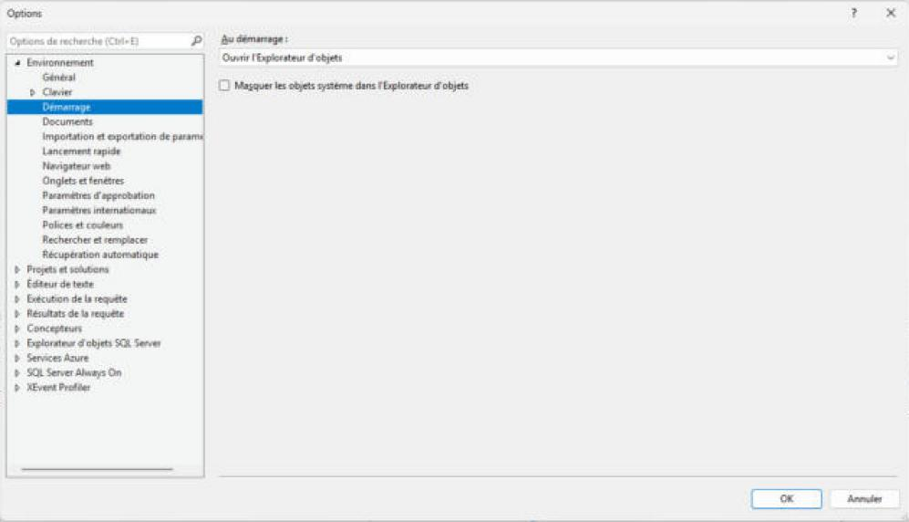

| Réglage | Valeur |
|---|---|
| **Au démarrage** | **Ouvrir l'Explorateur d'objets** |
| Masquer les objets système dans l'Explorateur d'objets | ☐ |

Choix de *Au démarrage* : **Ouvrir l'Explorateur d'objets** · Ouvrir la fenêtre de nouvelle requête · Ouvrir l'Explorateur d'objets et la fenêtre de requête · Ouvrir l'Explorateur d'objets et le Moniteur d'activité · Ouvrir l'environnement vide.

Avec « Ouvrir l'Explorateur d'objets », SSMS affiche **le dialogue de connexion dès le démarrage** (observé : au lancement, SSMS s'est retrouvé connecté au dernier serveur utilisé, après validation du dialogue pré-rempli).

### Éditeur de texte > Transact-SQL

**Général** :

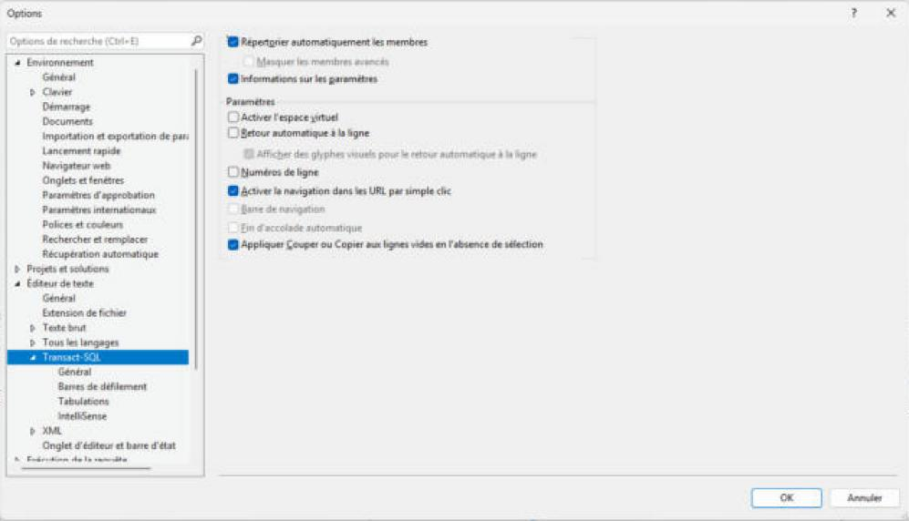

| Réglage | Valeur |
|---|---|
| Répertorier automatiquement les membres | ✔ |
| Masquer les membres avancés | ☐ (grisé) |
| Informations sur les paramètres | ✔ |
| Activer l'espace virtuel | ☐ |
| Retour automatique à la ligne | ☐ |
| **Numéros de ligne** | **☐ (pas de numéros de ligne par défaut)** |
| Activer la navigation dans les URL par simple clic | ✔ |
| Barre de navigation / Fin d'accolade automatique | grisés |
| Appliquer Couper ou Copier aux lignes vides en l'absence de sélection | ✔ |

**Barres de défilement** : barres horizontale et verticale affichées ; annotations dans la barre verticale (modifications, marques, **erreurs**, signe insertion) ✔ ; mode *barre* (et non *mappage*).

**Tabulations** : Mise en retrait *Bloc* ; Taille des tabulations *4* ; Taille du retrait *4* ; **Conserver les tabulations** (et non « Insérer des espaces »).

**IntelliSense** : Activer IntelliSense ✔ ; Souligner les erreurs ✔ ; Instructions de plan ✔ ; Taille de script maximale *1 Mo* ; Casse des noms de fonctions intégrées *Majuscules* (exemple : `DATEADD`).

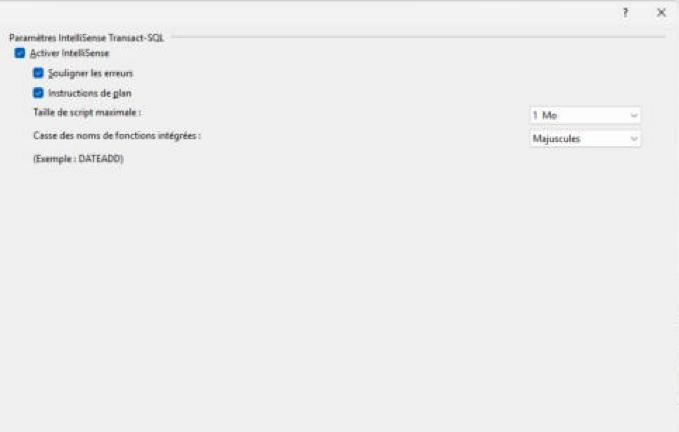
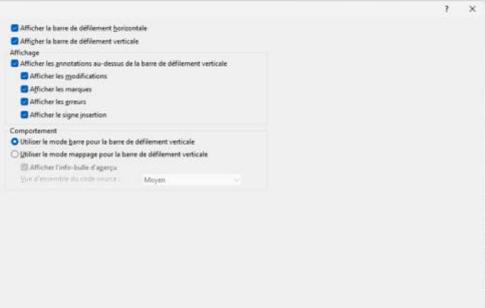
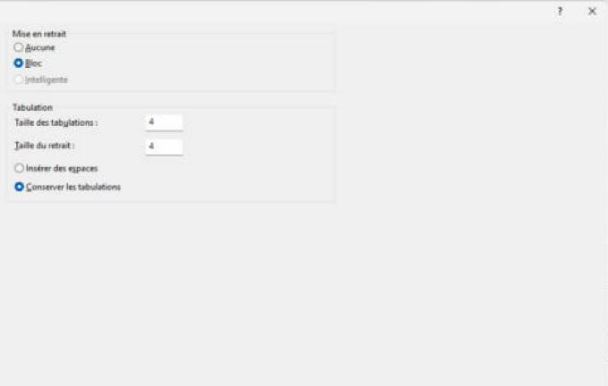

### Éditeur de texte > Onglet d'éditeur et barre d'état

C'est ici que se règlent **le texte des onglets et la barre d'état jaune** décrits en 02 et 04.

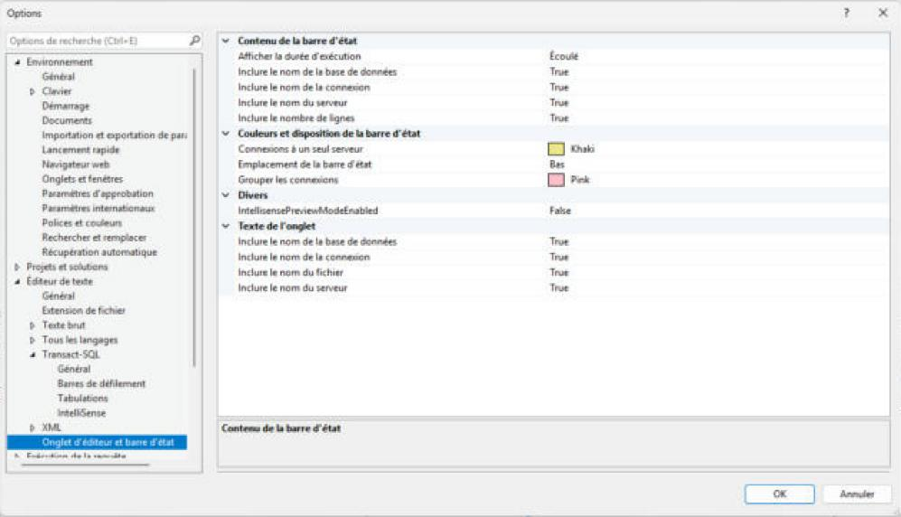

| Groupe | Réglage | Valeur |
|---|---|---|
| Contenu de la barre d'état | Afficher la durée d'exécution | Écoulé |
| | Inclure le nom de la base de données | True |
| | Inclure le nom de la connexion | True |
| | Inclure le nom du serveur | True |
| | Inclure le nombre de lignes | True |
| Couleurs et disposition | **Connexions à un seul serveur** | **Khaki** (la couleur jaune-kaki de la barre) |
| | Emplacement de la barre d'état | Bas |
| | **Grouper les connexions** | **Pink** (rose : requêtes sur un groupe de serveurs) |
| Divers | IntellisensePreviewModeEnabled | False |
| Texte de l'onglet | Inclure le nom de la base de données | True |
| | Inclure le nom de la connexion | True |
| | Inclure le nom du fichier | True |
| | Inclure le nom du serveur | True |

### Résultats de la requête

**SQL Server > Général** : Destination par défaut des résultats *Résultats dans des grilles* ; Emplacement par défaut d'enregistrement des résultats `C:\Users\<utilisateur>\Documents` ; Émettre le signal sonore… lorsqu'un lot est terminé ☐. Bouton *Rétablir les valeurs par défaut*.

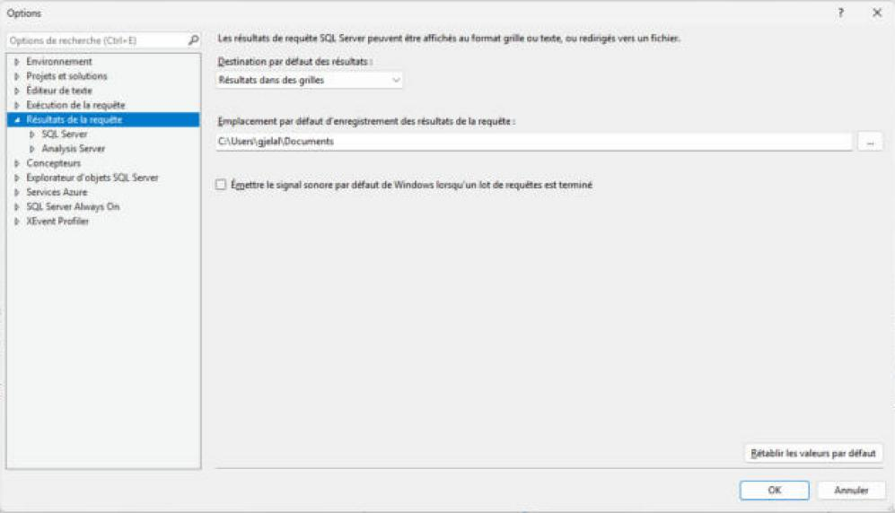

**Résultats dans des grilles** :

| Réglage | Valeur |
|---|---|
| Inclure la requête dans l'ensemble de résultats | ☐ |
| Inclure des en-têtes de colonne lors de la copie ou de l'enregistrement de résultats | ☐ (d'où l'entrée séparée « Copier avec en-têtes ») |
| Conserver les retours chariot/retours à la ligne lors de la copie ou de l'enregistrement | ☐ |
| Ignorer les résultats après l'exécution | ☐ |
| **Afficher les résultats dans un onglet séparé** | ☐ (par défaut, résultats sous l'éditeur) |
| Basculer vers l'onglet des résultats après l'exécution | ☐ (grisé) |
| Nombre maximal de caractères récupérés : Données non-XML | 65535 |
| Données XML | 2 Mo |

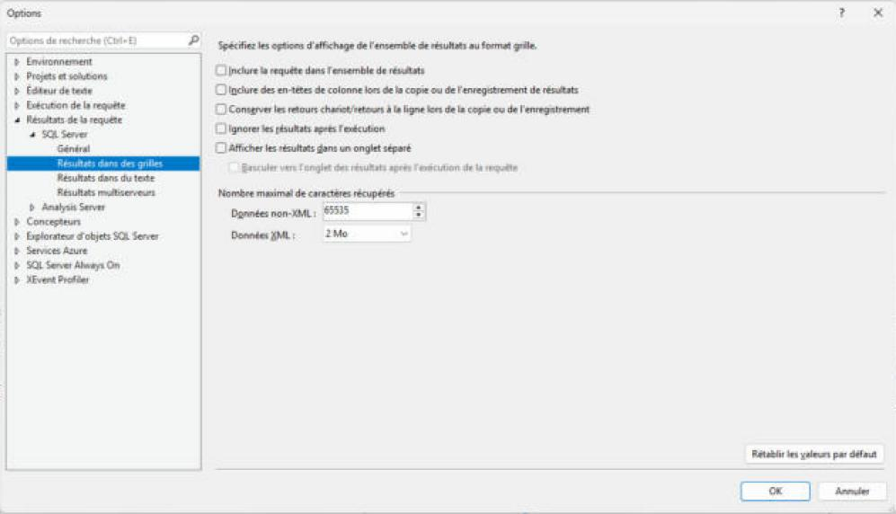

**Résultats dans du texte** : Format de sortie *Alignement de colonnes* ; Inclure des en-têtes de colonne ✔ ; Inclure la requête ☐ ; Défilement pendant réception des résultats ✔ ; Aligner les valeurs numériques à droite ☐ ; Ignorer les résultats ☐ ; Afficher les messages d'état dans un onglet séparé ☐ ; Afficher les résultats dans un onglet séparé ☐ ; Nombre maximal de caractères affichés dans chaque colonne *256*.

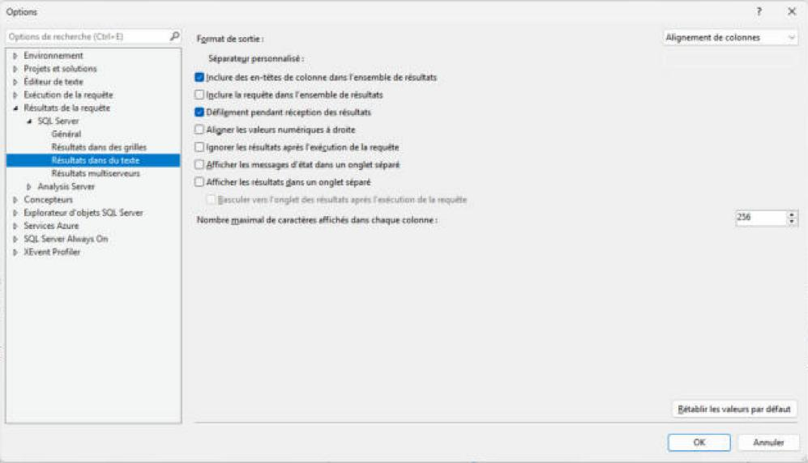

**Résultats multiserveurs** : Ajouter le nom de connexion aux résultats *False* ; Ajouter le nom de serveur aux résultats *True* ; Fusionner les résultats *True*.

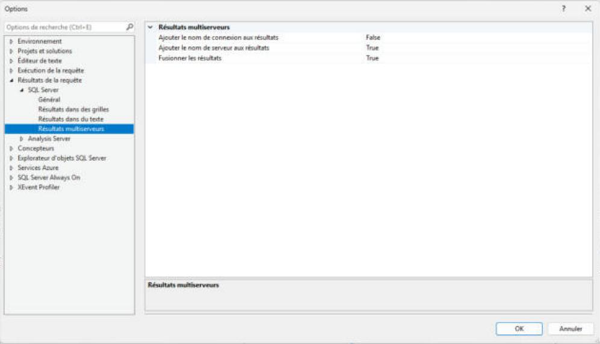

### Autres pages relevées

**Exécution de la requête > SQL Server** : SET ROWCOUNT *0* ; SET TEXTSIZE *2147483647* octets ; Délai d'exécution *0* s (illimité) ; **Délimiteur de lot `GO`** ; Par défaut, ouvrir les nouvelles requêtes en mode SQLCMD ☐ ; **Inviter à enregistrer les fenêtres de requête T-SQL non enregistrées à la fermeture ✔** (c'est ce réglage qui provoque la question vue en 02).

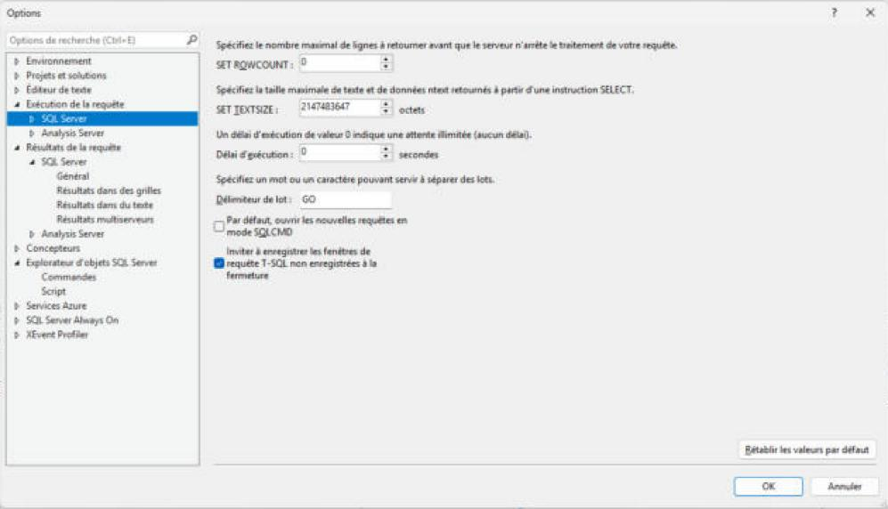

**Explorateur d'objets SQL Server > Commandes** : Mémoriser la position des boîtes de dialogue de tâches *False* ; Glisser-déposer : Entourer les noms d'objet de crochets *True*, Faire précéder le nom de l'objet glissé d'un schéma et d'un point *True* ; Inviter à confirmer le renommage des objets de schéma *True* ; **Valeur de la commande Sélectionner les \<n\> premières lignes *1000*** ; Valeur de la commande Modifier les \<n\> premières lignes *0* (valeur de ce poste ; le défaut de SSMS est 200).

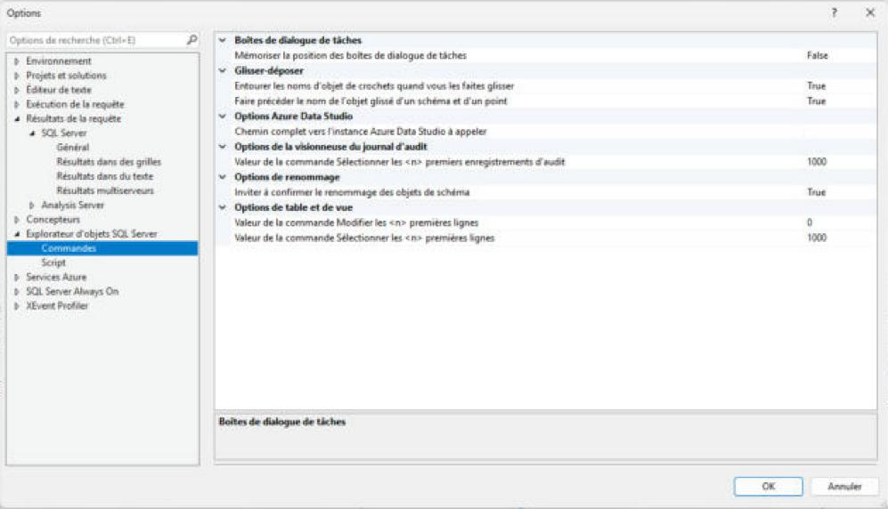

## 5.8 Disposition des fenêtres

Chaque panneau outil (Explorateur d'objets, Serveurs inscrits, Propriétés…) a trois boutons dans sa barre de titre :

| Bouton | Info-bulle | Effet |
|---|---|---|
| ▾ | (info-bulle non relevée) | menu ci-dessous |
| punaise | **Masquer automatiquement** | Le panneau se replie en un onglet vertical sur le bord de la fenêtre et se déplie au survol ou au clic (comportement Visual Studio, non testé ici). |
| ✕ | Fermer | Ferme le panneau ; on le rouvre par le menu *Affichage* (`F8` pour l'explorateur). Non testé. |

Menu **▾** : Rendre flottant · Ancrer (grisé s'il est déjà ancré) · Ancrer en tant que document avec onglet · Masquer automatiquement · Masquer.

- **Ancrer** : glisser la barre de titre d'un panneau affiche des repères d'ancrage (losanges) sur lesquels le déposer. *(Comportement Visual Studio, non testé pour ne pas déranger la disposition.)*
- **Réinitialiser** : *Fenêtre > Rétablir la disposition de fenêtre* (non cliqué).
- La barre de titre du panneau actif est **jaune** (« Explorateur d'objets » sur fond jaune quand il a le focus), celle des panneaux inactifs est bleu-gris.

Réglage lié : *Environnement > Général > « Le bouton Fermer n'affecte que la fenêtre Outil active »* ✔.
