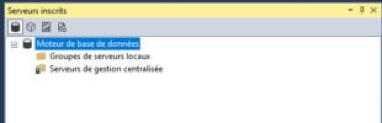
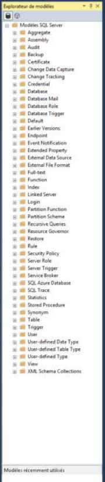
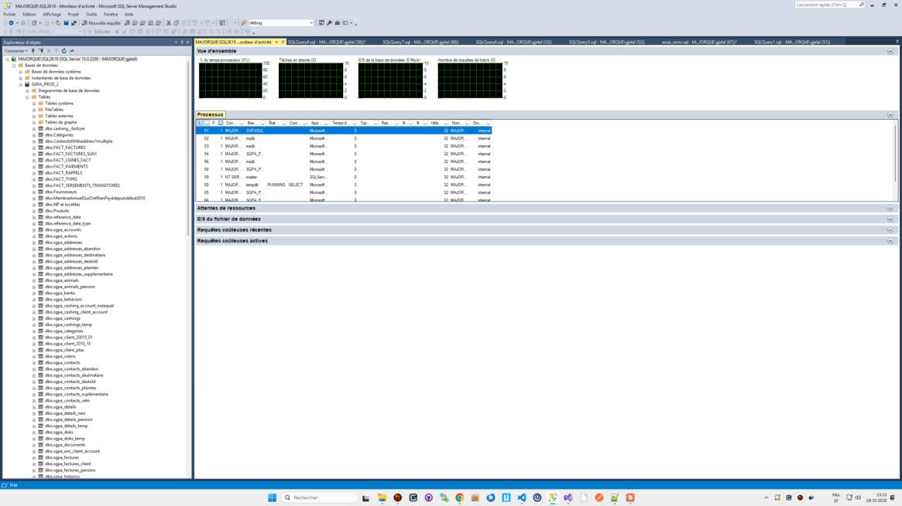
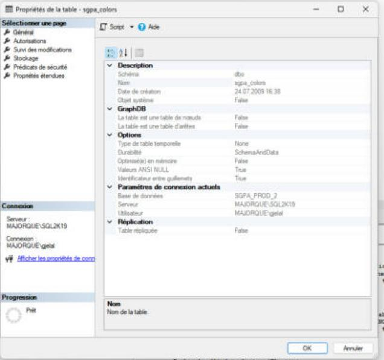

# 6. Divers

## 6.1 Serveurs inscrits

`Ctrl+Alt+G` ou *Affichage > Serveurs inscrits*. *(« Inscrire » un serveur = l'enregistrer dans une liste permanente, rangée en groupes, pour s'y connecter en un clic.)*

- S'ouvre comme un **panneau ancré au-dessus de l'Explorateur d'objets** (qui est réduit d'autant).
- Barre d'icônes : quatre boutons, un par type de serveur (le premier, sélectionné, est le Moteur de base de données ; les autres n'ont pas été survolés).
- Arbre : **Moteur de base de données** > **Groupes de serveurs locaux** et **Serveurs de gestion centralisée**. Ici, aucun serveur inscrit.
- Clic droit sur *Groupes de serveurs locaux* : Nouvelle requête · Explorateur d'objets · Évaluer les stratégies… · Importer des stratégies… · **Nouveau groupe de serveurs…** · **Nouvelle inscription de serveur…** · Démarrer PowerShell · Tâches ▸
- *Nouvelle requête* sur un **groupe** ouvre une requête exécutée sur tous les serveurs du groupe ; sa barre d'état prend la couleur « Grouper les connexions » (rose, voir 05). *(Non testé faute de groupe.)*
- Un serveur peut aussi être inscrit depuis l'explorateur : clic droit sur le serveur > **Inscrire…**
- Fermeture du panneau : `Maj+Échap` quand il a le focus, ou sa croix.

## 6.2 Explorateur de modèles

`Ctrl+Alt+T` ou *Affichage > Explorateur de modèles*. S'ouvre comme un **panneau ancré à droite**.

- Arbre **Modèles SQL Server** avec un dossier par type d'objet (en anglais) : Aggregate, Assembly, Audit, Backup, Certificate, Change Data Capture, Change Tracking, Credential, Database, Database Mail, Database Role, Database Trigger, Default, Earlier Versions, Endpoint, Event Notification, Extended Property, External Data Source, External File Format, Full-text, Function, Index, Linked Server, Login, Partition Function, Partition Scheme, Recursive Queries, Resource Governor, Restore, Rule, Security Policy, Server Role, Server Trigger, Service Broker, SQL Azure Database, SQL Trace, Statistics, Stored Procedure, Synonym, Table, Trigger, User, User-defined Data Type, User-defined Table Type, User-defined Type, View, XML Schema Collections.
- En bas : une zone **Modèles récemment utilisés**.
- Ouvrir un modèle (double-clic) crée une nouvelle requête contenant le modèle, avec des paramètres `<nom, type, valeur>` à remplir par `Ctrl+Maj+M` (même format que la « nouvelle procédure » décrite en 03). *(Non ouvert ici.)*

## 6.3 Moniteur d'activité

Clic droit sur un serveur > **Moniteur d'activité**. S'ouvre comme **un onglet de document** nommé `MAJORQUE\SQL2K19 - Moniteur d'activité`.

- **Vue d'ensemble** : quatre graphiques temps réel (fond noir, quadrillage vert) : *% du temps processeur*, *Tâches en attente*, *E/S de la base de données (Mo/s)*, *Nombre de requêtes de lots/s*.
- Sections repliables (barre grise avec un bouton ⌄ à droite) : **Processus**, Attentes de ressources, E/S du fichier de données, Requêtes coûteuses récentes, Requêtes coûteuses actives. Elles sont repliées à l'ouverture.
- **Processus** : une grille avec une ligne par connexion (ID de session, base, état, commande, application, temps d'attente, utilisateur, groupe de charge de travail…). Chaque en-tête de colonne a un petit menu de filtre. On y voit les SPID de chaque onglet de requête ouvert dans SSMS, et la connexion du moniteur lui-même (`RUNNING SELECT`).
- Le moniteur interroge le serveur en continu tant que l'onglet est ouvert.
- Pendant que le moniteur est actif, la barre d'outils SQL est grisée (ce n'est pas un éditeur de requête).

## 6.4 Propriétés d'une table

Clic droit sur une table > **Propriétés**. Fenêtre « Propriétés de la table - sgpa_colors » (même gabarit que la plupart des dialogues de SSMS).

- **À gauche** : *Sélectionner une page* (Général, Autorisations, Suivi des modifications, Stockage, Prédicats de sécurité, Propriétés étendues) ; *Connexion* (serveur, identifiant, lien *Afficher les propriétés de connexion*) ; *Progression* (« Prêt »).
- **En haut** : bouton **Script ▾** (sert à générer le SQL des changements au lieu de les appliquer ; non testé) et **Aide**.
- **À droite** : une grille de propriétés (boutons *par catégorie* / *alphabétique*) : Description (Schéma, Nom, Date de création, Objet système), GraphDB, Options (Type de table temporelle, Durabilité, Optimisé(e) en mémoire, Valeurs ANSI NULL, Identificateur entre guillemets), Paramètres de connexion actuels, Réplication. Les propriétés en lecture seule sont grisées. En bas, une zone décrit la propriété sélectionnée.
- **OK** / **Annuler**. *(Fermé avec Annuler.)*

## 6.5 Raccourcis clavier les plus utiles

Relevés dans les menus et info-bulles de ce poste (schéma de clavier par défaut).

**Connexion et requêtes**

| Raccourci | Action |
|---|---|
| `Ctrl+N` | Nouvelle requête avec la connexion actuelle |
| `Ctrl+O` | Ouvrir un fichier |
| `Ctrl+S` / `Ctrl+Maj+S` | Enregistrer / Enregistrer tout |
| `Ctrl+F4` | Fermer l'onglet |
| `Ctrl+U` | Aller à la liste des bases |
| `Alt+F8` | Ouvrir le serveur de la requête dans l'explorateur |
| `F8` | Afficher l'Explorateur d'objets |
| `F7` | Détails de l'Explorateur d'objets |
| `Ctrl+Alt+G` | Serveurs inscrits |
| `Ctrl+Alt+T` | Explorateur de modèles |
| `F4` | Fenêtre Propriétés |

**Exécution**

| Raccourci | Action |
|---|---|
| `F5` ou `Ctrl+E` | Exécuter (tout, ou la sélection) |
| `Alt+Pause` | Annuler l'exécution |
| `Ctrl+F5` | Analyser (vérifier la syntaxe) |
| `Ctrl+L` | Plan d'exécution estimé |
| `Ctrl+M` | Inclure le plan d'exécution réel (bascule) |
| `Maj+Alt+S` | Inclure les statistiques du client |
| `Ctrl+T` / `Ctrl+D` / `Ctrl+Maj+F` | Résultats en texte / en grille / dans un fichier |
| `Ctrl+R` | Masquer / afficher le volet de résultats |
| `F6` / `Maj+F6` | Volet suivant / précédent |
| `Ctrl+Maj+M` | Remplir les paramètres d'un modèle |
| `F5` (explorateur) | Actualiser le nœud sélectionné |

**Édition**

| Raccourci | Action |
|---|---|
| `Ctrl+K, Ctrl+C` / `Ctrl+K, Ctrl+U` | Commenter / décommenter les lignes |
| `Ctrl+Maj+U` / `Ctrl+Maj+L` | Majuscules / minuscules |
| `Alt+↑` / `Alt+↓` | Déplacer les lignes sélectionnées |
| `Ctrl+F` / `Ctrl+H` | Rechercher / remplacer |
| `Ctrl+Maj+H` | Remplacer dans les fichiers |
| `Ctrl+J` | Liste des membres (IntelliSense) |
| `Ctrl+Espace` | Compléter le mot |
| `Ctrl+Maj+Espace` | Informations sur les paramètres |
| `Ctrl+Maj+R` | Actualiser le cache IntelliSense |
| `Ctrl+B, Ctrl+I` | Activer / désactiver IntelliSense |
| `Ctrl+K, Ctrl+X` / `Ctrl+K, Ctrl+S` | Insérer un extrait / Entourer de |
| `Ctrl+K, Ctrl+B` | Gestionnaire des extraits de code |
| `Ctrl+Maj+Q` | Concepteur de requêtes |
| `Ctrl+Maj+V` | Presse-papiers circulaire |

**Grille de résultats**

| Raccourci | Action |
|---|---|
| `Ctrl+C` / `Ctrl+Maj+C` | Copier / copier avec en-têtes |
| `Ctrl+A` | Tout sélectionner |

**Fenêtres**

| Raccourci | Action |
|---|---|
| `Maj+Alt+Entrée` | Plein écran |
| `Maj+Échap` | Fermer le panneau outil actif |
| `Ctrl+Q` | Lancement rapide (zone de recherche en haut à droite) |
